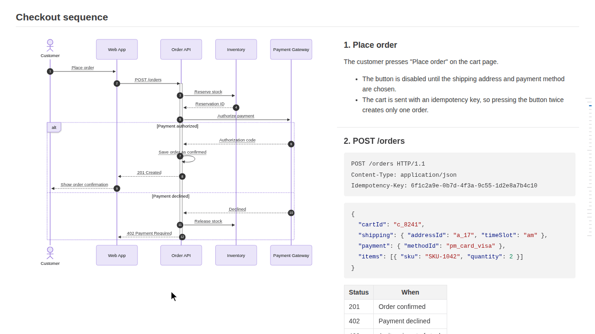
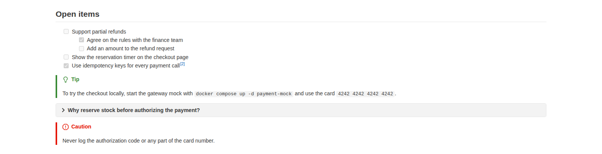
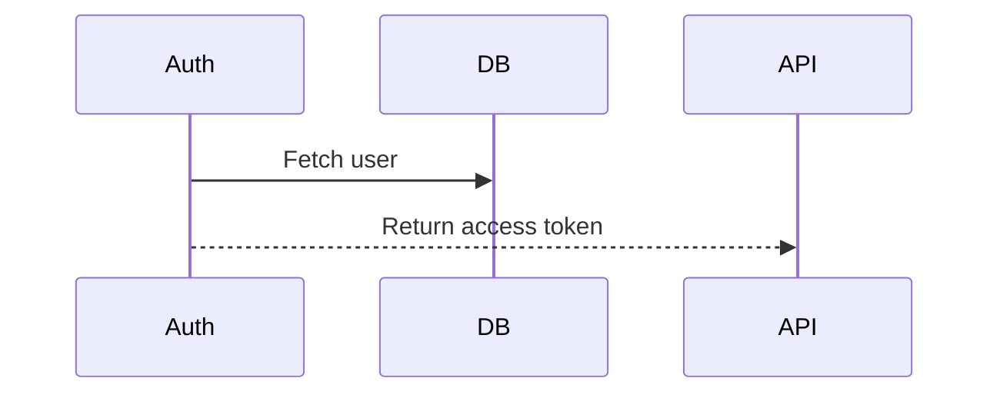
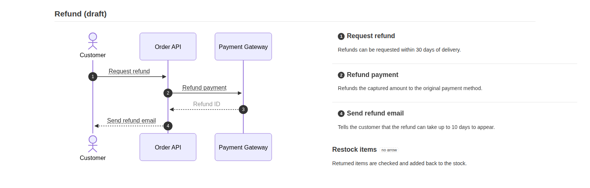
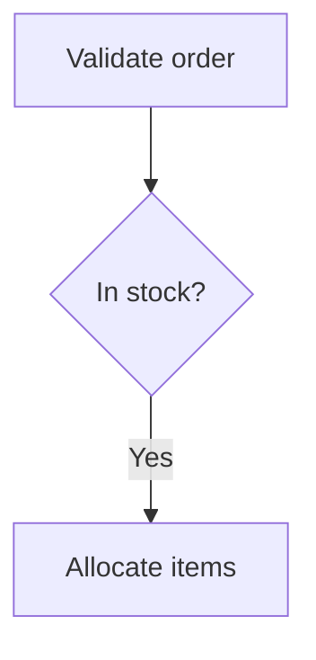
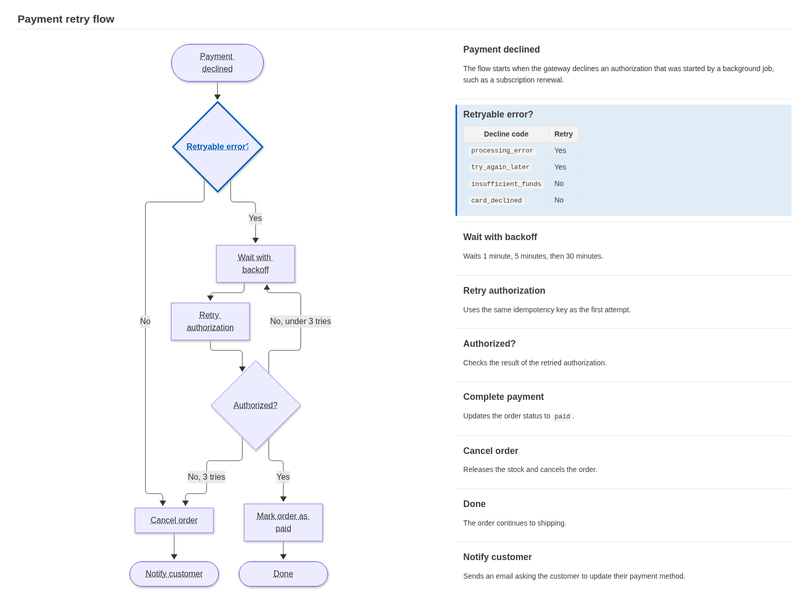
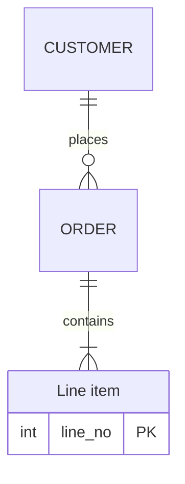
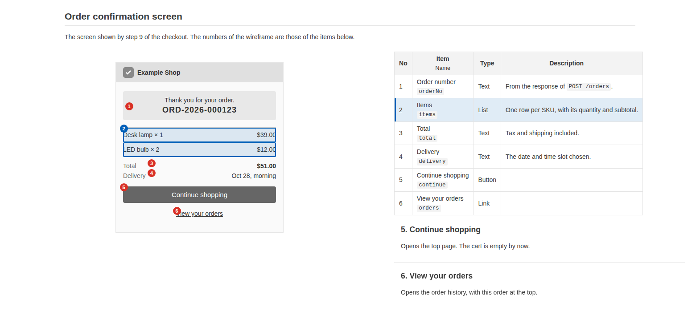
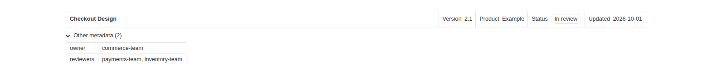
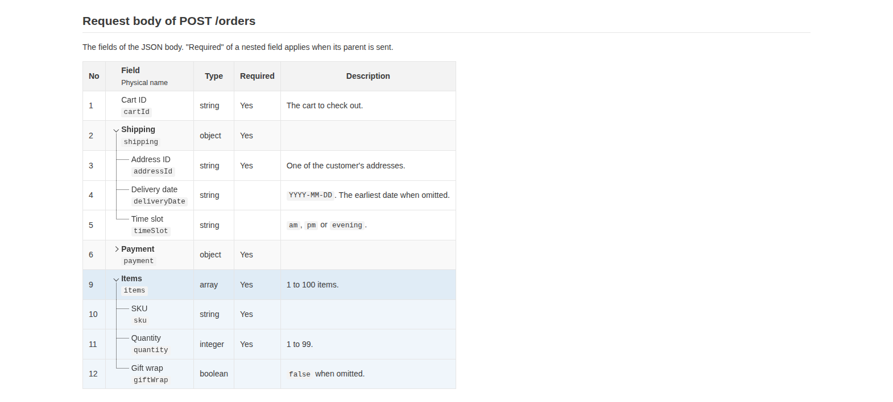

# Markdown Design Doc Viewer

[](https://github.com/playree/markdown-design-doc-viewer/actions/workflows/ci.yml)
[](https://marketplace.visualstudio.com/items?itemName=playree.markdown-design-doc-viewer)
[](https://marketplace.visualstudio.com/items?itemName=playree.markdown-design-doc-viewer)
[](LICENSE)

English | [日本語](README.ja.md) | [Website](https://playree.github.io/markdown-design-doc-viewer/)

A viewer for design documents written in Markdown. Its main feature shows **mermaid sequence diagrams and flowcharts side by side with their step descriptions**.
Each arrow (or flowchart node) in the diagram is linked to a heading in the description, so you can jump back and forth between them. ER diagrams and state diagrams can be linked to their headings too.



**[Live sample](https://playree.github.io/markdown-design-doc-viewer/sample/)**: a design document exported to HTML ([examples/screenshot.md](examples/screenshot.md)). Hover the arrows and headings to try the highlighting in your browser.

## Features

- **Side-by-side layout** — when the preview is wide enough, the diagram stays on the left (sticky) while the descriptions scroll on the right, with a line between linked steps. On narrow panes it falls back to the normal vertical layout.
- **Arrow / node ⇔ heading links** — hover or click an arrow (or a flowchart node, an ER diagram entity, a state or a part of a wireframe) to highlight its description, or click a heading to find it in the diagram.
- **Editor sync** — the preview follows the editor's scroll position and cursor (an arrow or node is highlighted when the cursor is on its line). Double-click in the preview to jump to the source line.
- **Plain Markdown** — the link syntax is made of mermaid comments and HTML comments, so the same file still renders correctly on GitHub and in the built-in Markdown preview.
- **Design document friendly** — YAML front matter is shown as a table of the document's metadata (title, version, status...), or as a header with `type: design_doc` (see below), code blocks are syntax highlighted, and GitHub alerts (`> [!NOTE]`), task lists (`- [ ]`) and footnotes (`[^1]`, whose note pops up when hovering the reference) are rendered.
- **Sticky table headers** — when scrolling through a long table, its header row stays at the top of the preview, so you can always see which column is which. It works in exported HTML too, and can be turned off with `mdDesignDoc.stickyTableHeader`.
- **Tables of items** — in tables of the items of a message, a file or a screen, a comment before the table shows two columns (such as the item name and the physical name) in one cell, and the rows as a tree of their levels: indented with lines, the parents emphasized and foldable, and the parents and children of the row under the pointer highlighted. Elsewhere, such as on GitHub, it stays a plain table (see [Tables of items](#tables-of-items)).
- **Wireframes** — screen mock-ups written as HTML files (or screens of a running app captured with the command line) are put into the document like images, with a number on each of their parts. Beside the headings and the rows of an item table numbered like them, their parts are linked to them like the arrows of a diagram (see [Wireframes](#wireframes)). On GitHub, an image you choose (or a link to the HTML file) stands for them.
- **Resizable** — drag the boundary between the columns to resize them; double-click it to reset. In a wide preview, the text is kept in a centered column up to 1280px wide; the button in the preview's title bar switches it to the full width and back.
- **Light / dark theme** — the preview follows VS Code's color theme by default. The button in the preview's title bar switches it to the other of light and dark (for example, to read a document in light while the editor stays dark), and pressing it again makes it follow VS Code again. The choice is saved in `mdDesignDoc.theme`.
- **Table of contents** — hover the short lines at the right edge of the preview to open a table of contents (h1–h3) and jump to a heading. The highlighted line shows where you are. It works in exported HTML too.
- **Diagram and image zoom** — hover a mermaid diagram and click the button at its top right to show it full screen. Scroll the wheel to zoom, drag to pan, double-click to fit it again and press Esc to close. Clicking a linked arrow closes it and shows the step. Images open the same way when clicked (except images in a link, which open the link).
- **Compare with Git history** — `Markdown Design Doc Viewer: Compare Design Doc with Git Revision...` (the history button in the preview's title bar, also in its context menu) lists the commits of the document and shows its differences from the one you choose in the preview: the blocks added, changed and deleted are marked with green, blue and red bands, the words changed are highlighted in the changed blocks, and the old version of a changed diagram is shown folded below it. The bar at the bottom goes from one change to the next, and closes the comparison. The differences follow the edits of the document, saved or not. It needs Git (the one of the setting `git.path`, or on the PATH). In the desktop app, use the **History** tab of the sidebar.
- **Design doc list** — `Markdown Design Doc Viewer: Show Design Docs` lists the design documents of the workspace (`type: design_doc` in their front matter) in a table of their titles, versions, statuses and update dates, with a search box and sortable columns. The **Design Docs** view of the Explorer shows them as a tree (see [Design doc list](#design-doc-list)).
- **Find** — press `Ctrl+F` (`Cmd+F` on macOS) in the preview to search it.
- **HTML export** — `Markdown Design Doc Viewer: Export Design Doc as HTML` (also in the preview's context menu) writes the document to a single HTML file, with the diagrams rendered in the light theme and local images embedded (like the preview, only images in the document's folder and the workspace; others stay links). The side-by-side layout and the arrow ⇔ heading highlighting work in the browser too, and printing lays it out vertically, so you can print it to PDF from the browser. Warnings and missing-link marks are left out. While the preview is compared with a Git revision, the differences are exported too, marked as in the preview, with a bar to go from one change to the next and to hide or show them, so that the readers of the latest version can see what changed. It also runs from the command line for CI and batch conversions (see [Command line (CI)](#command-line-ci)), where `--diff-base <revision>` exports the differences from a tag or a commit.



## Usage

Open a Markdown file and click the preview icon in the editor title bar, or run one of these commands from the Command Palette:

- `Markdown Design Doc Viewer: Open Design Doc Preview to the Side`
- `Markdown Design Doc Viewer: Open Design Doc Preview`

It can also be opened in place of the text editor: choose **Design Doc Preview** from **Reopen Editor With...** (the editor picker at the top right of the tab bar). To always open Markdown files with it, pick "Configure default editor for '*.md'" in that list, or add this to your settings:

```json
"workbench.editorAssociations": { "*.md": "mdDesignDoc.editor", "*.markdown": "mdDesignDoc.editor" }
```

## Writing linked documents

````markdown
---
type: design_doc
title: Login Feature Design
version: 1.0
product: Example
status: Draft
updated: 2026-10-11
---

# Login Feature Design

## Sequence



## Steps

### Fetch user

Look up the user by id.

### Issue token

Issue a JWT valid for one hour.

<!-- link-headings:end -->
````

| Syntax | Meaning |
|---|---|
| `%% @link-headings` | Required. Marks the diagram (a sequence diagram, a flowchart, an ER diagram or a state diagram) to be linked to and shown side by side with its descriptions. Write it anywhere inside the mermaid block. |
| Arrow label equals a heading | `Auth->>DB: Fetch user` links to the heading `Fetch user` automatically. |
| Numbered heading | `### 3. Fetch user` also links to `Fetch user` (`3.`, `3)`, `(3)`, `③`, `1.2.3` and similar prefixes are ignored when no heading matches exactly). |
| `%% @ref <heading>` | Links the **next** arrow to `<heading>` when its label differs from the heading. |
| `<!-- link-headings:end -->` | Optional. Ends the description column. Without it, the column extends to the next diagram with `%% @link-headings` or the end of the document. |
| Front matter | Optional. The metadata between the `---` lines is shown at the top as a table, or as the document's header with `type: design_doc` (see [Design document header](#design-document-header)). |

Rules:

- Only headings **after** the diagram (up to the end of the description column) are linked.
- Labels and headings are compared after trimming and collapsing whitespace; `<br/>` in a label counts as a space.
- Only diagrams with `%% @link-headings` are shown side by side (even if no arrow is linked). Other diagrams are rendered normally, and an `@ref` in them is reported as a warning.
- `%% @link-headings` has no effect on a diagram inside a list or blockquote; this is reported as a warning.
- An `@ref` whose heading cannot be found is reported as a warning at the top of the preview. The × button hides the warnings temporarily; they are shown again when they change.
- With `autonumber`, linked headings show the arrow's number, unless the heading already starts with it (`### 3. Fetch user`). Turn `mdDesignDoc.headingNumbers` off to hide them.
- To help spot missing descriptions, arrows without a linked heading are shown faded, and headings at the same level as the linked ones but without an arrow get a "no arrow" mark. Diagrams with no links at all get no marks.
- The same warnings and missing links are also reported in the Problems panel for open Markdown files, even when no preview is open. A diagram with `%% @link-headings` but no links at all is reported there too.
- In the editor, the headings of the overview are completed after `%% @ref ` (those without an arrow first). The missing-link diagnostics come with quick fixes (light bulb, `Ctrl+.`): link the arrow to a heading without an arrow by writing a `@ref`, add a heading with the arrow's text to the overview, or point a broken `@ref` to an existing heading.
- Warnings, marks and tooltips are shown in English or Japanese, following the VS Code display language.



### Flowcharts

Flowcharts (`graph` / `flowchart`) are linked the same way, with their **nodes** in place of arrows:

````markdown


## Validate order

## In stock?

## Reserve stock
````



- A node is linked to the heading with the text of its label (`A[Validate order]` → `Validate order`). A node without a label (`A`) uses its id and is not reported as missing a heading. Edge labels are not linked.
- `%% @ref <heading>` links the node defined on the next line: the first node labeled on it, else the first node appearing there for the first time, else its first node.
- Horizontal flowcharts (`LR` / `RL`) are too wide to put beside their steps, so the steps are always shown below them. The links work the same.
- Nodes without a linked heading are shown faded, and step headings without a node get a "no node" mark.
- Flowcharts have no `autonumber`, so no numbers are shown on the headings.

### ER diagrams and state diagrams

ER diagrams (`erDiagram`) and state diagrams (`stateDiagram` / `stateDiagram-v2`) are linked like flowcharts, with their **entities** and **states** in place of nodes, for example to put the definition of each table or the description of each state beside the diagram:

````markdown


## CUSTOMER

## ORDER

## Order lines
````

- An entity is linked to the heading with the text of its alias (`LINE_ITEM["Line item"]` → `Line item`), or of its name when it has no alias. A state is linked to the heading with its description (`state "Paid" as S2`, or `S2 : Paid`; the first one when it has several), or with its id when it has none. Unlike flowchart nodes, entities and states without a label are reported when no heading is linked to them.
- Composite states (`state Fulfillment { … }`) and the states inside them are linked too. The start and end (`[*]`), forks, joins, choices and notes are not.
- Relationship and transition labels are not linked.
- `%% @ref <heading>` links the entity or state defined on the next line: the first one defined on it (with its attributes, its alias or its description, or on its own), else the first one appearing there for the first time, else its first one.
- With `direction LR` / `RL`, the headings are always shown below the diagram, as for horizontal flowcharts.
- Entities and states without a linked heading are shown faded, and headings without one get a "no entity" or "no state" mark.

See [examples/er-diagram.md](examples/er-diagram.md) and [examples/state-diagram.md](examples/state-diagram.md).

### Wireframes

Screen designs can have their wireframe beside the description of its parts. Write the screen as an HTML file (a static mock-up), number its parts with `data-item`, and put it into the document like an image:

````markdown
<!-- wireframe: link-headings width=375 -->
[](screens/login.html)

<!-- table: item=No merge=Item,Name -->
| No | Item | Name | Type |
|---|---|---|---|
| 1 | Member ID | `memberId` | Text box |
| 2 | Password | `password` | Password box |
| 4 | Sign in | `signIn` | Button |

### 4. Sign in

Calls the sign-in API with the member ID and the password.
````

```html
<!-- screens/login.html -->
<link rel="stylesheet" href="wireframe.css">
<label>Member ID <input type="text" data-item="1"></label>
<label>Password <input type="password" data-item="2"></label>
<button data-item="4">Sign in</button>
```



- A paragraph made of an image of a local `.html` (or `.htm`) file, of a link to one, or of an image in such a link is shown as a wireframe: ``, `[Sign-in screen](screens/login.html)` or `[](screens/login.html)`. The links are taken only at the top level, not in a list or a blockquote, and a link in a sentence stays a link. The image of the last one is optional: GitHub and other viewers show it in place of the wireframe (the others show the text, or the link).
- The HTML is shown in a frame as in a browser, with its own styles, which do not apply to the document (nor those of the document to it). Its local style sheets (`<link rel="stylesheet">`) and images are read relative to it, from the document's folder and the workspace like images, and embedded into exported HTML. Its text can be selected and copied, and its form controls used (they are reset when the preview is updated), but its links and forms do not leave the document. Scripts are not run and external style sheets are not loaded: write a static page, or capture a screen of a running app (see [Screens of a running app](#screens-of-a-running-app)). The preview follows the changes of its files.
- Number the parts with `data-item="<number>"` (full-width digits too). The number is shown at the top left of each part. Elements with the same number are one part (for example the options of a radio button).
- Parts can also be numbered in the options, without changing the HTML: `item.<number>="<CSS selector>"` numbers the elements matching the selector (`item.1="#email"`, `item.4="form button[type=submit]"`) as if they had `data-item`. Write the quotes of the selector as `'`; the options may span several lines. A selector that matches nothing, or is not a valid one, is noted below the wireframe.
- The options are written in an HTML comment right before it (on the line before it, or with a blank line between): `link-headings` puts it beside the headings and the item tables after it and links its parts to them, like `%% @link-headings` for a diagram (up to `<!-- link-headings:end -->`, the next linked diagram or wireframe, or the end of the document). `width=<pixels>` lays the page out at that width (for example `375` for a phone) and scales it down to fit the column; without it, the page is as wide as the column. `stacked` always puts the headings below it, for wide screens.
- A part is linked to the first heading after it numbered like it (`### 4. Sign in`, `### (4) Sign in`, `### ④ Sign in`...), or to the heading of `data-ref="<heading>"` on its element, and to the rows of the item tables with its number in the column of `item=` (see [Tables of items](#tables-of-items)). Hovering and clicking a part, a heading or a row highlight and scroll both ways.
- Parts linked to no heading nor row have a faded number, and the headings at the level of the linked ones and the rows without a part get a "no part" mark; the Problems panel reports them too. A file that cannot be read, a `data-item` that is not a number and a `data-ref` to a missing heading are reported as warnings.
- Hover a wireframe and click the button at its top right to show it full screen, as for diagrams. There too, its text can be selected and its form controls used: drag the space around the page, or hold Space and drag, to pan it.

See [examples/wireframe.md](examples/wireframe.md).

#### Screens of a running app

Instead of writing a mock-up, a screen of a web app that runs (on its development server, for example, also a single-page app that its scripts draw) can be captured as the HTML file of a wireframe with the [command line](docs/cli.md#capturing-screens): the page as it is shown, with the styles that apply to it and its images and fonts embedded, without its scripts. Actions before it is captured show what the first view does not, such as an error message or a dialog. Its parts are numbered with `item.<number>=` in the options, which stay when it is captured again.

```sh
npx markdown-design-doc-viewer capture http://localhost:5173/signin -o screens/signin-error.html --width 375 \
  --fill '#email=a@example.com' --click 'button[type=submit]' --wait-for '[role=alert]'
```

````markdown
<!-- wireframe: link-headings width=375
  item.1="#email"
  item.2="input[name='password']"
  item.3="button[type=submit]"
  item.4="[role=alert]"
-->
[Sign-in screen with an error](screens/signin-error.html)
````

The page is laid out as in the window it was captured in: write its `--width` as the `width=` of the wireframe.

## Design document header

Writing `type: design_doc` in the YAML front matter of design documents is recommended. The main metadata is then shown as the document's header instead of a table:

```markdown
---
type: design_doc
title: Checkout Design
version: 2.1
product: Example
status: In review
updated: 2026-10-01
owner: commerce-team
reviewers:
  - payments-team
  - inventory-team
---

# Checkout Design
```



- The header is a box with `title` in bold on the left, and `version`, `product`, `status` and `updated` on the right (in this order, leaving out those not written), separated by lines.
- The other entries (`owner` and `reviewers` here) are shown in a table folded below the header (closed by default). `type` itself is not shown.

### Design doc list

The documents with `type: design_doc` can be listed with their metadata:

- `Markdown Design Doc Viewer: Show Design Docs` (also the list button in the title bar of the **Design Docs** view) opens a page with a table of the design documents of the workspace, by folder: their title, file name, `version`, `product`, `status` and `updated`. The search box filters them (by title, file name or metadata; words separated by spaces must all match), and clicking a column header sorts them by that column (again for the reverse order, a third time for the order of the list). Clicking a title opens its preview. The list follows the files added, changed and deleted. The light / dark button in its title bar switches the theme, as in the preview.
- The **Design Docs** view of the Explorer shows the same documents as a tree of their titles by folder, with their version and status. Click one to open its preview, or use the button at its right to open it in the editor.
- The files excluded by `files.exclude`, those in `node_modules` and in folders starting with a dot are not listed.
- In the desktop app, **View** > **Design Docs** shows the list of the folder of the sidebar in place of the document. On the command line, `--index-design-docs` lists only the design documents in `index.html` (see [the command line's README](docs/cli.md)).

## Tables of items

Tables of the items of a message, a file or a screen tend to have many columns, and their nesting is hard to read. Write the table options in an HTML comment right before the table (on the line before it, or with a blank line between):

```markdown
<!-- table: level=Level merge=Item,"Physical name" -->
| No | Level | Item | Physical name | Type | Length | Required | Description |
|---|---|---|---|---|---|---|---|
| 1 | 1 | Order | `order` | - | - | Yes | |
| 2 | 2 | Order ID | `orderId` | string | 12 | Yes | Assigned by the Order API. |
| 3 | 2 | Customer | `customer` | - | - | Yes | |
| 4 | 3 | Customer ID | `customerId` | string | 10 | Yes | |
| 5 | 2 | Total | `total` | integer | 1–9 | Yes | Tax included. |
```



- `merge=A,B` shows the cells of column B under those of column A, smaller, in one column (the header too). More columns can follow (`merge=A,B,C`), an empty cell adds no line, and `merge=` can be written more than once.
- `level=L` takes the integers in column L as the depth of each row (the lowest is the top; full-width digits are accepted) and hides the column. The rows are shown as a tree in the column right of it (left of it when it is the last column; with `merge=`, the merged cell): indented with lines, and the rows with children emphasized. Click ▾ before a row to fold its children (they are all printed), and point to a row to highlight its parents and children (`mdDesignDoc.tableTreeHighlight` turns this off). A row more than one level deeper than the row above is taken as its child.
- `item=N` takes the numbers in column N as those of the parts of the wireframe before the table, to link the rows to them (see [Wireframes](#wireframes)).
- Columns are named by the text of their header. Quote a name with spaces or commas (`"Physical name"`).
- To see a table as it is (all its columns, without the tree), point to it and click the button at the right of its header row; click it again to go back. This is kept while the document is edited, but not saved: the table is shown with its options again when the document is reopened. It works in exported HTML too.
- Options that cannot be applied (a column that does not exist, a level that is not an integer, a comment not followed by a table) are reported as warnings at the top of the preview and in the Problems panel.
- Without the comment (and on GitHub or in other viewers), the table is shown as it is.

## Writing with AI

To have an AI assistant (Claude Code, GitHub Copilot, Cursor and so on) write documents in this format, give it the [authoring guide for AI](docs/ai-authoring-guide.md) ([日本語](docs/ai-authoring-guide.ja.md)). Copy it into your project's instructions file (`CLAUDE.md`, `AGENTS.md`, `.github/copilot-instructions.md` and so on), or tell the assistant to read it.

The guide is also packaged with the usage of the [command line](#command-line-ci) as an [Agent Skill](https://agentskills.io/): download [markdown-design-doc-skill.zip](https://github.com/playree/markdown-design-doc-viewer/releases/latest/download/markdown-design-doc-skill.zip), and upload it to the skills of Claude (claude.ai), or unzip it into `~/.claude/skills/` or the project's `.claude/skills/` for Claude Code (or the skills folder of another assistant that supports Agent Skills). The assistant then uses it when asked to write a design document, without copying the guide into the instructions file. The skill is in English, and writes in the language of the request.

The guide also tells the assistant to read the diagnostics of the file. Agents that can read VS Code diagnostics (for example Copilot agent mode, or Claude Code connected to VS Code) can then find and fix arrows and headings that are not linked.

## Desktop app

The preview also comes as a desktop app for Windows, macOS and Linux, to read design documents without VS Code. It shows a document like the preview of the extension, updates it when the file is saved, exports it to the same HTML file as the extension, and compares it with its Git history. It has its own version and releases: download the installer from the [releases of the desktop app](https://github.com/playree/markdown-design-doc-viewer/releases?q=desktop&expanded=true).

The installers are not signed yet. See [the desktop app's guide](docs/desktop.md) for the warnings of the system on the first launch, and its usage.

## Command line (CI)

The HTML export also runs from the command line, to convert documents in CI or in a batch, without VS Code. It writes the same HTML file as the `Export Design Doc as HTML` command, with the diagrams rendered by the preview in headless Chrome. It needs Node.js 22 or later, and Chrome or Chromium.

```sh
npx markdown-design-doc-viewer export docs -o site     # all the Markdown files under docs/ to site/docs/*.html
npx markdown-design-doc-viewer export docs -o site --index --diff-base v1.0   # with their changes since the tag v1.0, and a list of them
```

It also captures a screen of a running web app as the HTML file of a wireframe (`capture`, see [Screens of a running app](#screens-of-a-running-app)).

See [the command line's README](docs/cli.md) for its options and an example of GitHub Actions.

## Settings

| Setting | Default | Description |
|---|---|---|
| `mdDesignDoc.splitMinWidth` | `1000` | Minimum preview width (px) for the side-by-side layout. |
| `mdDesignDoc.limitContentWidth` | `true` | In a wide preview, keep the text in a centered column up to 1280px wide (diagrams beside their steps still use the whole width). Also switched with the button in the preview's title bar, and applied to exported HTML. |
| `mdDesignDoc.stickyTableHeader` | `true` | Keep the header row of a long table at the top while scrolling through it (preview and exported HTML). |
| `mdDesignDoc.tableTreeHighlight` | `true` | In a table shown as a tree (`level=` of the [table options](#tables-of-items)), highlight the parents and children of the row under the pointer (preview and exported HTML). |
| `mdDesignDoc.syncEditor` | `true` | Sync the preview with the editor and enable double-click to jump to the source. |
| `mdDesignDoc.toc` | `true` | Show the table of contents at the right edge of the preview (preview and exported HTML). |
| `mdDesignDoc.headingNumbers` | `true` | With `autonumber`, show the arrow's number at the start of its linked heading (preview and exported HTML). |
| `mdDesignDoc.diagramLook` | `neo` | Look of the mermaid diagrams: `neo` (mermaid's default, with shadows on flowchart nodes) or `classic` (flat, without shadows). A diagram with `config: look:` in its front matter keeps its own. |
| `mdDesignDoc.theme` | `auto` | Color theme of the preview: `auto` (VS Code's), `light` or `dark`. Also switched with the button in the preview's title bar. Exported HTML is always light. |
| `mdDesignDoc.frontMatter` | `true` | Show the YAML front matter at the top as a table of metadata, or as a header with `type: design_doc`. When off, it is hidden. |
| `mdDesignDoc.diagnostics` | `true` | Report link warnings and missing links of open Markdown files in the Problems panel. |
