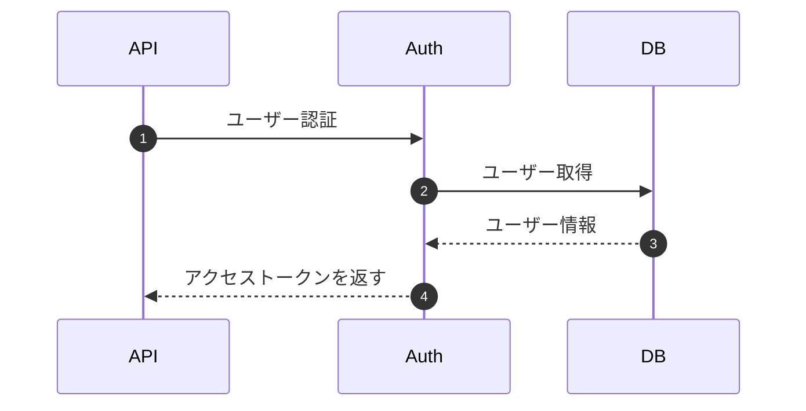

# Markdown 設計書ビューア向けの設計書の書き方

[English](ai-authoring-guide.md) | 日本語

設計書を Markdown で書くときは、次の規則に従ってください。設計書は VS Code 拡張「Markdown 設計書ビューア」でプレビューします。プレビューでは、mermaid のシーケンス図（またはフローチャート、ER 図、状態遷移図）を左に、その後ろの処理概要を右に並べ、図の矢印（フローチャートではノード、ER 図ではエンティティ、状態遷移図では状態）を同じ文言の見出しに紐付けます。すべての矢印（ノード・エンティティ・状態）が見出しに紐付き、処理概要のすべての見出しがそのいずれかに紐付いている状態を目指してください。画面設計書では、画面のワイヤーフレーム（HTML ファイル）を、番号を振ったパーツの説明と並べて表示することもできます。エッジ・リレーション・遷移のラベルは紐付かないので、それらの見出しは書かないでください。

## テンプレート

````markdown
---
type: design_doc
title: ログイン機能 設計書
version: 1.0
product: <プロダクト名>
status: 作成中
updated: 2026-10-10
---

# ログイン機能 設計書

<details>
<summary>変更履歴</summary>

| 版 | 日付 | 内容 |
|---|---|---|
| 1.0 | 2026-10-10 | 初版 |

</details>

## シーケンス



## 処理概要

### 1. ユーザー認証

処理内容、入力、入力チェック、エラー。

### 2. ユーザー取得

検索条件と、認証に失敗する条件。

### 3. ユーザー情報

返す列。

### 4. トークン発行

トークンのクレーム。有効期限は 1 時間[^expiry]。

<!-- link-headings:end -->

## 次の節

[^expiry]: 有効期限を短くしたいが、リフレッシュトークンに対応するまでは 1 時間にする。
````

## シーケンス図

- 処理の流れは、`sequenceDiagram` で始まる ` ```mermaid ` ブロック 1 つに書く。
- ブロックの中に `%% @link-headings` を独立した行で書く。これがないと横並びにならず、何も紐付かない。
- 図は文書のトップレベルに置く。リストや引用の中には置かない。
- 矢印の文言（`:` の後ろ）は短くし、図の中で重複させない。この文言が処理概要の見出しになる。
- `autonumber` は使ってよい。プレビューでは、矢印の番号が見出しの横に表示される（`mdDesignDoc.headingNumbers` がオフの場合を除く）。
- ほかの mermaid の図（クラス図、ガントチャート、`%% @link-headings` のない図など）は通常どおり表示される。その中には `%% @ref` を書かない。

## フローチャート

シーケンス図の代わりにフローチャート（`flowchart TD` / `graph TD`）を紐付けることもできる。矢印の代わりにノードが見出しと紐付く。処理概要の規則は「矢印」を「ノード」と読み替えて適用する。

- シーケンス図と同じく、ブロックの中に `%% @link-headings` を独立した行で書く。
- 処理のノードには、図の中で重複しない短いラベルを付ける（`A[注文を検証]`）。このラベルが処理概要の見出しになる。ラベルのないノードは処理として扱われない。
- 処理のノードは、エッジを書く前に 1 行に 1 つずつラベル付きで定義する。こうすると、その直前の行に書いた `%% @ref <見出しの文言>` がそのノードに付く。
- 処理概要と並べる流れは `TD`（上から下）で書く。`LR` / `RL` のフローチャートは、処理概要を横ではなく下に表示する。
- エッジのラベル（`-->|はい|`）は見出しと紐付かない。

## ER 図・状態遷移図

ER 図（`erDiagram`）や状態遷移図（`stateDiagram-v2`）も同じように紐付けられる。矢印の代わりにエンティティ・状態が見出しと紐付く。ER 図の後ろにテーブルごとの定義を、状態遷移図の後ろに状態ごとの説明を見出しで書く、といった使い方をする。処理概要の規則は「矢印」を「エンティティ」「状態」と読み替えて適用する。

- シーケンス図と同じく、ブロックの中に `%% @link-headings` を独立した行で書く。
- エンティティは別名（`LINE_ITEM["注文明細"]`）、なければ名前と同じ文言の見出しに紐付く。状態は説明（`state "支払い済み" as S2`）、なければ ID と同じ文言の見出しに紐付く。ラベルの有無にかかわらず、すべてのエンティティ・状態に見出しを書く。
- 複合状態（`state 出荷処理 { … }`）とその中の状態も紐付く。`[*]`、fork・join・choice、ノートは紐付かない。
- リレーション・遷移のラベルは見出しと紐付かない。
- エンティティ・状態を別の文言の見出しに紐付けるときは、それを 1 行で定義し（属性を書く `ORDER {`、`S2 : 支払い済み`、`state "支払い済み" as S2`）、その直前の行に `%% @ref <見出しの文言>` を書く。
- 見出しを図の横に並べるときは `direction LR` / `RL` を書かない。横向きの図は見出しを下に表示する。

## ワイヤーフレーム

画面設計書では、画面のワイヤーフレームを各パーツの説明と並べて表示できる。画面を静的な HTML ファイルとして設計書の近くに書き、画像と同じように設計書に取り込む。

```markdown
<!-- wireframe: link-headings width=375 -->
[ログイン画面](screens/login.html)

<!-- table: item=No merge=項目名,物理名 -->
| No | 項目名 | 物理名 | 種別 | 必須 | 説明 |
|---|---|---|---|---|---|
| 1 | 会員 ID | `memberId` | テキストボックス | ○ | |
| 2 | パスワード | `password` | パスワード | ○ | |
| 3 | ログイン | `signIn` | ボタン | | |

### 3. ログイン
```

- HTML はモックとして書く。素の要素（`<input>`、`<button>`、`<a>`、リスト、表）と、`<style>` 要素またはローカルのスタイルシート（`<link rel="stylesheet" href="wireframe.css">`）の CSS を使う。スクリプトは実行されず、外部のスタイルシートは読み込まれない。ローカルの画像は HTML ファイルからの相対パスで書く。
- 設計書で説明するパーツの要素すべてに、画面を読む順に 1 から `data-item="<番号>"` を付ける。1 つのパーツである要素（ラジオボタンの選択肢、リストの各行）には同じ番号を付ける。
- ワイヤーフレームは段落に単独で書く: `[文言](file.html)`、``、または GitHub が代わりに表示する画面の画像を付けた `[](file.html)`。パーツを紐付けるには、直前の行に `<!-- wireframe: link-headings -->` を書く。幅が決まった画面には `width=<ピクセル数>`（スマホは `375`、PC の画面は `1280` など）を、横に広い画面には説明を下に並べる `stacked` を加える。
- パーツはワイヤーフレームの後ろの項目の表で説明する。`No` 列に番号を書き、表のオプションに `item=No` を書く。1 行で説明しきれないパーツ（ボタンの処理、入力の規則など）には、パーツと同じ番号の見出し（`### 3. ログイン`）を書く。行と見出しの両方を書いてもよい。番号のない見出しに紐付けるときは、要素に `data-ref="<見出しの文言>"` を書く。
- すべてのパーツに行か見出しを書き、項目の表のすべての行と、番号を付けた見出しと同じレベルのすべての見出しに、対応するパーツを置く。説明の最後に `<!-- link-headings:end -->` を書く。

## 処理概要

- 処理概要は図の **後ろ** に、矢印の順に、矢印 1 本につき見出し 1 つで書く。
- 処理の見出しのレベルはすべてそろえる。通常は、図を含む節の見出しより 1 つ下のレベルにする。
- 見出しの文言は矢印の文言と同じにする。前後の空白と連続する空白は無視して比較し、矢印の文言中の `<br/>` は空白として扱う。
- 見出しの先頭には番号を付けてよい。`### 3. ユーザー取得` は矢印「ユーザー取得」に紐付く。番号を付けるなら `autonumber` の番号と合わせる。
- 見出しを矢印の文言と変えたいときは、図の中で、その矢印の直前の行に `%% @ref <見出しの文言>` を書く。この方法で、複数の矢印（要求と応答など）を同じ見出しに紐付けてもよい。
- 処理と同じレベルに、どの矢印とも紐付かない見出しを作らない。「矢印なし」（フローチャートでは「ノードなし」、ER 図では「エンティティなし」、状態遷移図では「状態なし」）の印が付く。補足は段落、1 つ下のレベルの見出し、または終わりのマーカーの後ろに書く。
- リストや引用の中の見出しは処理として扱われない。
- 最後の処理の後ろに、`<!-- link-headings:end -->` をトップレベルの独立した行で書く。これがないと、次の `%% @link-headings` 付きの図か文書の末尾までが処理概要になる。

## メタ情報（front matter）

- 設計書の先頭には YAML front matter を書き、`type: design_doc` を入れる。文書の 1 行目を `---` にし、次の行から `key: value` の形でメタ情報を書き、`---` の行で閉じる（`---` の直後の行が `key: value` の形でないと front matter として扱われない）。
- `title`・`version`・`product`・`status`・`updated` は文書のヘッダとして横並びで表示される。それ以外のキーは、ヘッダの下の折りたたみ（既定で閉じた状態）に表で表示される。
- 本文の先頭には、`title` と同じ文言の `#` 見出しも書く。

## 脚注

- 本文の流れを止めたくない補足（理由、根拠、経緯、細かい注意点）は脚注にする。本文の該当箇所に `[^ラベル]` を書き、定義 `[^ラベル]: 内容` は文書の末尾にまとめて書く。ラベルは内容が分かる名前にする（`[^expiry]`）。
- プレビューでは、脚注は文書の末尾に集めて表示され、参照にマウスを載せると内容がポップアップする。
- 仕様そのもの（処理内容、入力チェックの条件、エラー）は脚注にせず、本文に書く。
- 見出しに脚注を付けてもよい。紐付けの照合では脚注の参照は無視される。

## 折りたたみ

- 常に読む必要のないものは `<details>` で折りたたむ。たとえば、変更履歴、検討した代替案や経緯、長い一覧表（エラーコードなど）、長いサンプル（JSON、SQL）。仕様の要点は折りたたまない。
- 変更履歴は、`#` 見出しの直後に表を折りたたんで置く（テンプレートを参照）。最新の版と日付は front matter の `version`・`updated` と合わせる。
- `<details>`、`<summary>…</summary>`、`</details>` はそれぞれトップレベルの独立した行に書く。`<summary>` の行の後には空行を入れる。空行がないと、中の Markdown（表やリスト）が表示されない。`</details>` の行の前にも空行を入れる。
- 折りたたみの中には見出しを書かない。中の見出しは折りたたみの外の見出しと同じに扱われ、処理概要の中では処理の見出しとして数えられる。小見出しが要るときは太字にする。

## 項目の表

電文・ファイル・画面の項目の表（項目名・物理名・型・桁…）には、表の直前の行に表のオプションを HTML コメントで書く。ほかの環境ではふつうの表のまま表示される。

```markdown
<!-- table: level=階層 merge=項目名,物理名 -->
| No | 階層 | 項目名 | 物理名 | 型 | 必須 | 説明 |
|---|---|---|---|---|---|---|
| 1 | 1 | 注文 | `order` | - | ○ | |
| 2 | 2 | 注文 ID | `orderId` | 文字列 | ○ | |
| 3 | 2 | 明細 | `items` | - | ○ | |
| 4 | 3 | SKU | `sku` | 文字列 | ○ | |
```

- `merge=A,B` は、列 B を列 A の下に 1 つのセルで表示する。項目名と物理名に使う。3 つ以上の列もまとめられ（`merge=A,B,C`）、`merge=` は複数書ける（`merge="桁 最小","桁 最大"`）。空のセルは行を足さない。
- `level=L` は、列 L の整数（最上位が 1）を各行の深さとし、その列を隠して、すぐ右の列で行をツリーとして表示する。入れ子の項目（XML の要素、JSON のオブジェクト）は、親を説明文に書く代わりに、項目名の直前に階層の列を足す。`merge=` と一緒に使うと、まとめたセルにツリーを表示する。
- すべての行の階層を整数で書き、子は親より 1 つ深くする。上の行より 2 つ以上深い行もその子として扱うが、階層を飛ばさない。
- `item=N` は、列 N の番号で、表の前にあるワイヤーフレームのパーツと行を紐付ける（「ワイヤーフレーム」を参照）。
- 列はヘッダの文言で指定する。空白やカンマを含む名前は引用符で囲む（`"桁 最小"`）。
- 適用できないオプション（存在しない列、整数でない階層、直後が表でないコメント）は警告になる。

## その他の Markdown

- 表、言語を指定したコードブロック（` ```json `、` ```sql `）、GitHub のアラート（`> [!NOTE]`、`> [!TIP]`、`> [!IMPORTANT]`、`> [!WARNING]`、`> [!CAUTION]`）、タスクリスト（`- [ ]`、`- [x]`）が表示される。

## 確認

ファイルを VS Code で開いていると、拡張機能が紐付けの問題を、ソースが `Markdown Design Doc` の診断として報告する。報告されるのは、見出しのない矢印（ノード）、矢印（ノード）のない処理の見出し、存在しない `@ref` の見出し、効いていない `%% @link-headings`、適用できない表のオプション、行や見出しのないワイヤーフレームのパーツ（とパーツのない行・見出し）である。設計書を書いたり直したりした後は、そのファイルの診断を読み、診断がなくなるまで設計書を直すこと。
