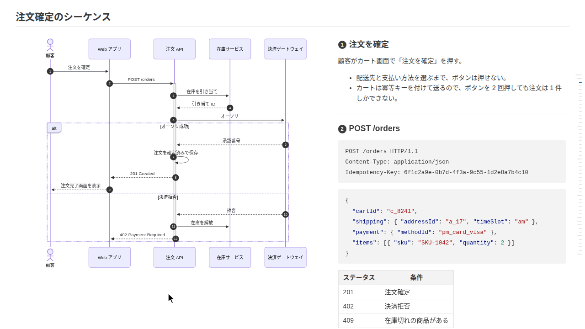

# markdown-design-doc-viewer-embed

[](https://www.npmjs.com/package/markdown-design-doc-viewer-embed)
[](https://github.com/playree/markdown-design-doc-viewer/blob/main/LICENSE)

[English](https://github.com/playree/markdown-design-doc-viewer/blob/main/docs/embed.md) | 日本語

[Markdown 設計書ビューア](https://github.com/playree/markdown-design-doc-viewer/blob/main/README.ja.md)のビューアを、Web アプリの部品にしたものです。Markdown で書いた設計書を、VS Code 拡張のプレビューと同じようにページの要素の中に表示します。**mermaid のシーケンス図・フローチャート・ER 図・状態遷移図と処理概要を横並びにして**、矢印（ノード）と見出しを紐付け、画面のワイヤーフレームと項目の表も紐付けます。目次、front matter の設計書のヘッダ、ライト・ダークのテーマもあります。



## インストール

```sh
npm install markdown-design-doc-viewer-embed mermaid
```

図を描く [mermaid](https://www.npmjs.com/package/mermaid) 12 は peer dependency です。React の部品を使うときは React と React DOM 19 も要ります。ほかに使うライブラリ（markdown-it、DOMPurify、highlight.js など）は同梱しています。

アプリのバンドラ（Vite、webpack、Next.js、esbuild など）で取り込む ES モジュールです。

## React

```tsx
import { DesignDocViewer } from 'markdown-design-doc-viewer-embed/react';
import 'markdown-design-doc-viewer-embed/viewer.css';

export function DesignDoc({ markdown }: { markdown: string }) {
  return <DesignDocViewer markdown={markdown} baseUrl="https://example.com/docs/" style={{ height: 600 }} />;
}
```

- **高さが要ります。** ビューアはその高さいっぱいに広がり、中でスクロールします。
- props は下のオプションと、要素に付ける `className`・`style` です。
- `readFile` と `resolveResource` が変わると描画し直すので、描画のたびに変わらないようにします（`useCallback`）。ほかのコールバックは変わってもかまいません。
- `lang` はビューアを作るときだけ読みます。変わるとビューアを作り直します。
- `ref` で `scrollToLine(line)`・`markLine(line)` を呼べます（`DesignDocViewerHandle`）。
- `react.js` はクライアントコンポーネント（`'use client'`）なので、Next.js のサーバーコンポーネントからも使えます。設計書はブラウザで表示します。

## React を使わない場合

```ts
import { createViewer } from 'markdown-design-doc-viewer-embed';
import 'markdown-design-doc-viewer-embed/viewer.css';

const viewer = createViewer(element, { markdown, baseUrl: 'https://example.com/docs/' });
await viewer.ready; // 図も含めて表示し終わった
await viewer.update({ markdown: edited, theme: 'dark' }); // documentId が同じならスクロール位置を保つ
viewer.destroy();
```

`createViewer(container, options)` は `container`（高さが要ります）の中にビューアを作ります。返す `Viewer` には次があります。

| | |
| --- | --- |
| `ready` | 図も含めて設計書を表示し終わると解決します。 |
| `update(options)` | オプション（`lang` 以外）を変えて描画し直します。表示し終わると解決します。 |
| `scrollToLine(line)` | Markdown のこの行（0 始まり）が先頭に来るようにスクロールします。 |
| `markLine(line)` | この行（0 始まり）の要素に印を付け、見えるところまでスクロールします（エディタのカーソルの行など）。 |
| `destroy()` | ビューアを要素から取り除きます。 |

## オプション

| オプション | 既定値 | |
| --- | --- | --- |
| `markdown` | （必須） | 設計書の Markdown。 |
| `documentId` | | 文書を見分けます。変わると別の文書として先頭から表示し、同じ間は（編集したときのように）スクロール位置を保って更新します。 |
| `baseUrl` | | 設計書のフォルダの URL。画像とワイヤーフレームのパスをここから解決します（`readFile` がなければワイヤーフレームを `fetch` で読みます）。 |
| `readFile` | `baseUrl` から `fetch` | `(path) => Promise<string \| undefined>`: ワイヤーフレームのファイル（HTML とそのスタイルシート）を読みます。`path` は設計書に書いたパス（設計書からの相対パス、`/` で始まればルートから）をデコードしたもの。読めなければ undefined を返します。 |
| `resolveResource` | `baseUrl` から解決 | `(src) => string`: 設計書の画像の `src` の URL。 |
| `lang` | ブラウザの言語 | `'en'` か `'ja'`: ビューアの文言の言語。ビューアを作るときだけ読みます。 |
| `theme` | `'auto'` | `'light'`、`'dark'`、またはシステムに合わせる `'auto'`。 |
| `diagramLook` | `'neo'` | 図の見た目。`'neo'` か `'classic'`（フラット）。 |
| `splitMinWidth` | `1000` | 図と処理概要を横並びにするビューアの幅（px）。 |
| `toc` | `true` | 右側の目次。 |
| `limitContentWidth` | `true` | 本文の幅を制限します。 |
| `stickyTableHeader` | `true` | 長い表のヘッダ行をスクロールしても上に固定します。 |
| `tableTreeHighlight` | `true` | 木構造で表示した表の行の親子をハイライトします。 |
| `frontMatter` | `true` | front matter を（設計書のヘッダ、または表として）表示します。 |
| `headingNumbers` | `true` | 紐付いた見出しに `autonumber` の番号を表示します。 |
| `onOpenLink` | `openLinkInNewTab` | `(href) => void`: 設計書のリンク（ビューアがスクロールする `#見出し` 以外）を開きます。既定では http(s) と mailto のリンクを新しいタブで開き、ほかは何もしません。 |
| `onRevealLine` | | `(line) => void`: ビューアでダブルクリックした Markdown の行（0 始まり）で呼ばれます（エディタでその行を表示するなど）。ないときはダブルクリックしても何もしません。 |

## スタイル

`viewer.css` はビューアのスタイルで、すべてビューアの要素（`.seqnotes-viewer`）の下に効き、ライト・ダークのテーマの色も含みます。**カスケードレイヤーに入れずに**（`@import "…" layer(components)` などにせずに）そのまま読み込んでください。設計書の要素（見出し・リスト・表など）のスタイルは詳細度を持たない（`:where()`）もので、ビューアはレイヤーに入れた CSS リセット（レイヤー `base` に入る Tailwind CSS v4 の preflight など）が消すブラウザの既定のスタイルを戻します。レイヤーの外にあるので、それらに勝ちます。レイヤーの外にある、ページの要素に対するグローバルなスタイル（`h1 { … }` や、Tailwind CSS v3 の preflight・normalize.css などのリセット）はビューアの中にも効きます。

## サーバーサイドレンダリング

モジュールはサーバー（Next.js など）で import できます。document や window を使うのはビューアを作るときだけです。`DesignDocViewer` はビューアを effect の中、つまりブラウザで作ります。

## 制約

- mermaid の設定はグローバルです。ページの複数のビューアは図を順番に描き、ビューアが自分の設定で mermaid を初期化します。mermaid は自分の DOMPurify にフックを足します。
- ワイヤーフレームの `@font-face` は、Shadow DOM の中ではフォントを読み込まないので、ページに追加します（`document.adoptedStyleSheets`）。
- 拡大した図と脚注のポップアップは、ページ全体の上に表示します（`position: fixed`）。
- 画像は同期で解決します（`resolveResource`）。URL から読むようにしてください。
- リビジョンとの差分（拡張の Git の比較）は表示できません。

## 書き方

図に `%% @link-headings` を書くと、その後ろの見出しに紐付きます。矢印・ノードと見出しは文言、または `%% @ref` で対応付けます。記法は[書き方](https://github.com/playree/markdown-design-doc-viewer/blob/main/README.ja.md#書き方)を、画面は[ワイヤーフレーム](https://github.com/playree/markdown-design-doc-viewer/blob/main/README.ja.md#ワイヤーフレーム)を見てください。

## ライセンス

[MIT](https://github.com/playree/markdown-design-doc-viewer/blob/main/LICENSE)。同梱したライブラリのライセンスは ThirdPartyNotices.txt にあります。
