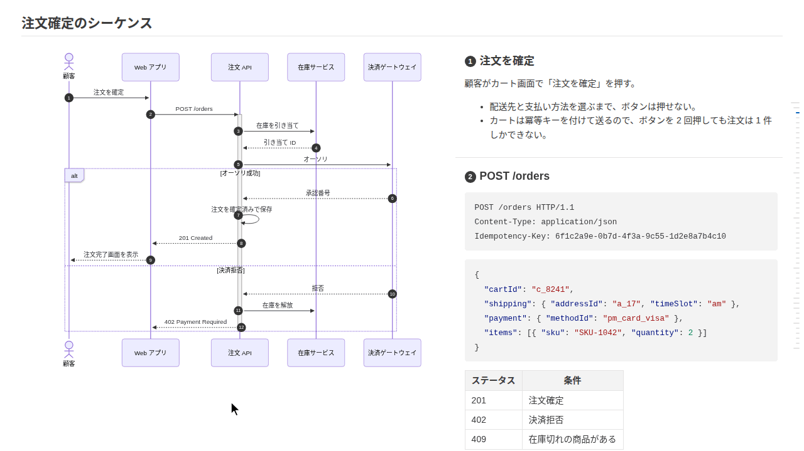

# markdown-design-doc-viewer-embed

[](https://www.npmjs.com/package/markdown-design-doc-viewer-embed)
[](https://github.com/playree/markdown-design-doc-viewer/blob/main/LICENSE)

[English](https://github.com/playree/markdown-design-doc-viewer/blob/main/docs/embed.md) | 日本語

[Markdown 設計書ビューア](https://github.com/playree/markdown-design-doc-viewer/blob/main/README.ja.md)のビューアを、Web アプリの部品にしたものです。Markdown で書いた設計書を、VS Code 拡張のプレビューと同じようにページの要素の中に表示します。**mermaid のシーケンス図・フローチャート・ER 図・状態遷移図と処理概要を横並びにして**、矢印（ノード）と見出しを紐付け、画面のワイヤーフレームと項目の表も紐付けます。目次、front matter の設計書のヘッダ、ライト・ダークのテーマもあります。拡張と同じく、設計書を 1 つの HTML ファイルに書き出すこともできます（[HTML ファイルに書き出す](#html-ファイルに書き出す)）。



## インストール

```sh
npm install markdown-design-doc-viewer-embed mermaid
```

図を描く [mermaid](https://www.npmjs.com/package/mermaid)（`^12.3.0`）は peer dependency です。React の部品を使うときは React と React DOM（`^19.3.1`）も要ります。ほかに使うライブラリ（markdown-it、DOMPurify、highlight.js など）は同梱しています。

アプリのバンドラ（Vite、webpack、Next.js、esbuild など）で取り込む ES モジュールです。

## React

```tsx
import { DesignDocViewer } from 'markdown-design-doc-viewer-embed/react';
import 'markdown-design-doc-viewer-embed/viewer.css';

export function DesignDoc({ markdown }: { markdown: string }) {
  return <DesignDocViewer markdown={markdown} baseUrl="https://example.com/docs/" style={{ height: 600 }} />;
}
```

- **高さが要ります。** ビューアはその高さいっぱいに広がり、中でスクロールします。
- props は下のオプションと、要素に付ける `className`・`style` です。
- `readFile` と `resolveResource` が変わると描画し直すので、描画のたびに変わらないようにします（`useCallback`）。ほかのコールバックは変わってもかまいません。
- `lang` はビューアを作るときだけ読みます。変わるとビューアを作り直します。
- `ref` で `scrollToLine(line)`・`markLine(line)` を呼べます（`DesignDocViewerHandle`）。
- `react.js` はクライアントコンポーネント（`'use client'`）なので、Next.js のサーバーコンポーネントからも使えます。設計書はブラウザで表示します。

## React を使わない場合

```ts
import { createViewer } from 'markdown-design-doc-viewer-embed';
import 'markdown-design-doc-viewer-embed/viewer.css';

const viewer = createViewer(element, { markdown, baseUrl: 'https://example.com/docs/' });
await viewer.ready; // 図も含めて表示し終わった
await viewer.update({ markdown: edited, theme: 'dark' }); // documentId が同じならスクロール位置を保つ
viewer.destroy();
```

`createViewer(container, options)` は `container`（高さが要ります）の中にビューアを作ります。返す `Viewer` には次があります。

| | |
| --- | --- |
| `ready` | 図も含めて設計書を表示し終わると解決します。 |
| `update(options)` | オプション（`lang` 以外）を変えて描画し直します。表示し終わると解決します。 |
| `scrollToLine(line)` | Markdown のこの行（0 始まり）が先頭に来るようにスクロールします。 |
| `markLine(line)` | この行（0 始まり）の要素に印を付け、見えるところまでスクロールします（エディタのカーソルの行など）。 |
| `destroy()` | ビューアを要素から取り除きます。 |

## オプション

| オプション | 既定値 | |
| --- | --- | --- |
| `markdown` | （必須） | 設計書の Markdown。 |
| `documentId` | | 文書を見分けます。変わると別の文書として先頭から表示し、同じ間は（編集したときのように）スクロール位置を保って更新します。 |
| `baseUrl` | | 設計書のフォルダの URL。画像とワイヤーフレームのパスをここから解決します（`readFile` がなければワイヤーフレームを `fetch` で読みます）。 |
| `readFile` | `baseUrl` から `fetch` | `(path) => Promise<string \| undefined>`: ワイヤーフレームのファイル（HTML とそのスタイルシート）を読みます。`path` は設計書に書いたパス（設計書からの相対パス、`/` で始まればルートから）をデコードしたもの。読めなければ undefined を返します。 |
| `resolveResource` | `baseUrl` から解決 | `(src) => string`: 設計書の画像の `src` の URL。 |
| `lang` | ブラウザの言語 | `'en'` か `'ja'`: ビューアの文言の言語。ビューアを作るときだけ読みます。 |
| `theme` | `'auto'` | `'light'`、`'dark'`、またはシステムに合わせる `'auto'`。 |
| `diagramLook` | `'neo'` | 図の見た目。`'neo'` か `'classic'`（フラット）。 |
| `splitMinWidth` | `1000` | 図と処理概要を横並びにするビューアの幅（px）。 |
| `toc` | `true` | 右側の目次。 |
| `limitContentWidth` | `true` | 本文の幅を制限します。 |
| `stickyTableHeader` | `true` | 長い表のヘッダ行をスクロールしても上に固定します。 |
| `tableTreeHighlight` | `true` | 木構造で表示した表の行の親子をハイライトします。 |
| `frontMatter` | `true` | front matter を（設計書のヘッダ、または表として）表示します。 |
| `headingNumbers` | `true` | 紐付いた見出しに `autonumber` の番号を表示します。 |
| `messageWrapWidth` | `40` | シーケンス図の矢印のラベルをこの文字数（全角は 2 文字と数える）で改行します。`0` にすると改行しません。 |
| `onOpenLink` | `openLinkInNewTab` | `(href) => void`: 設計書のリンク（ビューアがスクロールする `#見出し` 以外）を開きます。既定では http(s) と mailto のリンクを新しいタブで開き、ほかは何もしません。 |
| `onRevealLine` | | `(line) => void`: ビューアでダブルクリックした Markdown の行（0 始まり）で呼ばれます（エディタでその行を表示するなど）。ないときはダブルクリックしても何もしません。 |
| `compareWith` | | 設計書の別の版（古い版など）の Markdown。指定すると、`markdown` をその版からの差分付きで表示します（[版との差分を表示する](#版との差分を表示する)）。ないときは設計書だけを表示します。 |
| `compareLabel` | | 比べる版の説明（`バージョン 3（2026-11-01）と比較` など）。差分バーに表示します。 |
| `onCloseDiff` | | `() => void`: 差分バーを閉じたとき（× ボタン）に呼ばれます（`compareWith` を外すなど）。ないときは、`compareWith` が変わるまでビューアが設計書だけを表示します。 |

## 版との差分を表示する

```tsx
<DesignDocViewer
  markdown={latest}
  compareWith={compared?.markdown}
  compareLabel={compared ? `バージョン ${compared.version} と比較` : undefined}
  onCloseDiff={() => setCompared(undefined)}
  style={{ height: 600 }}
/>
```

`compareWith` に設計書の別の版の Markdown を渡すと、拡張の Git の版との比較と同じく、`markdown` をその版からの差分付きで表示します。追加・変更・削除したブロックに印を付け、変更したブロックでは変わった語を示し、変更した図の下には変更前の図を（折りたたんで）表示します。下部の差分バーには、比べている版（`compareLabel`）、変更したブロックの数と、変更の間を移動するボタンを表示します。古い版から新しい版への変更を見るときは、新しい版を `markdown` に、古い版を `compareWith` に渡します。

- `compareWith` を外す（`undefined` にする）と、設計書だけの表示に戻ります。
- 差分バーの × ボタンは `onCloseDiff` を呼びます。利用側はそこで `compareWith` を外します。`onCloseDiff` がないときは、`compareWith` が変わるまでビューアが自分で設計書だけを表示します。
- ワイヤーフレームのファイルは設計書のものを使い、比べません。
- `exportHtml` も `compareWith` と `compareLabel` を受け取ります。書き出したファイルは差分を表示し、差分バーで差分を隠したり表示したりできます。

## 設計書一覧

```tsx
import { DesignDocList } from 'markdown-design-doc-viewer-embed/react';

<DesignDocList
  documents={[
    { markdown: loginMarkdown, href: '/docs/login', file: 'login.md' },
    { markdown: frontMatterOnly, href: '/docs/screens/top', folder: 'screens', file: 'top.md' },
  ]}
  onOpenLink={(href) => router.push(href)}
/>
```

`DesignDocList`（React を使わないときは `createDesignDocList(container, options)`）は、拡張・デスクトップアプリの設計書一覧と同じ一覧を表示します。フォルダごとの表に、文書のタイトルとファイル名、front matter の版数・プロダクト・ステータス・更新日（どれかの文書が持つ列）を並べ、絞り込みの入力欄と並べ替えられる列見出しが付きます。ビューアと違って高さは要らず、一覧の高さで表示します。`createDesignDocList` は `ready`、`update(options)`（絞り込みと並び順は保ちます）、`destroy()` を返します。

- 文書の `markdown` は Markdown 全体か、front matter だけでもかまいません。タイトルとメタ情報はビューアと同じように読み取ります。
- `documents` が変わると表示し直すので、変わらない間は描画のたびに同じ配列を渡してください（`useMemo`）。

| オプション | 既定値 | |
| --- | --- | --- |
| `documents` | （必須） | `{ markdown, href, folder?, file?, title? }[]`: 文書。`href` はタイトルのリンク。`folder`（フォルダの間は `/`、最上位は `''`）ごとに表と見出しを分けます。`file` はタイトルの横に出します。`title` は Markdown のタイトル（front matter の `title`、最初の `#` の見出し、`file`、または `href`）の代わりに使います。 |
| `title` | `設計書一覧`（`Design Docs`） | 一覧の見出し。 |
| `fileLabel` | `ファイル`（`File`） | `file` の列の見出し（ページの番号など）。 |
| `filterPlaceholder` | | 絞り込みの入力欄のプレースホルダ。既定ではタイトル・ファイル名・メタ情報を挙げます。 |
| `empty` | | 文書がないときの文言。既定は拡張と同じです。 |
| `keepOrder` | `false` | フォルダと文書を、名前順ではなく `documents` の順（フォルダは最初の文書の位置）に並べます。 |
| `lang`, `theme`, `limitContentWidth` | ビューアと同じ | ビューアと同じオプション（[オプション](#オプション)）。 |
| `onOpenLink` | `openLinkInPage` | `(href) => void`: タイトルのリンクを開きます。既定ではページをそのリンクへ移します（`javascript:`・`data:`・`vbscript:` のリンクを除く）。`#` で始まるリンクは、代わりに一覧の中のその位置へスクロールします。 |

## HTML ファイルに書き出す

```ts
const { exportHtml } = await import('markdown-design-doc-viewer-embed/export');

const html = await exportHtml({
  markdown,
  lang: 'ja',
  title: '設計書', // 設計書にタイトルがないとき
  resolveImage: async (path) => toDataUri(path), // 画像をファイルに埋め込む
});
// 例: ファイルとしてダウンロードさせる
const link = document.createElement('a');
link.href = URL.createObjectURL(new Blob([html], { type: 'text/html' }));
link.download = 'design-doc.html';
link.click();
setTimeout(() => URL.revokeObjectURL(link.href), 1000);
```

`exportHtml(options)` は、設計書を 1 つの HTML ファイルにした文字列を返します。拡張の **Export Design Doc as HTML** や CLI の `md-design-doc export` と同じファイルです。スタイルとスクリプトを含むので、そのファイルだけで目次、図と処理概要の横並び、矢印と見出しのハイライト、印刷したときの縦並びが動きます。ライトテーマで、警告と紐付け漏れの印は入れません。

- 図はビューアと同じく、呼び出したページの中でブラウザが描きます。図はそのスタイルで測るので、ビューアと同じく `viewer.css` を読み込んでください。ページのビューアの配色は変わりません（mermaid の描画は順番に行います）。
- 描けない図は、ビューアと同じくエラーとともにファイルに入ります。そのときも `exportHtml` は完了します。
- `export.js` は書き出すファイルのスタイルとスクリプトを含みます（ビューアの `index.js` には入っていません）。使うときに読み込んでください（`import()`）。

| オプション | 既定値 | |
| --- | --- | --- |
| `markdown` | （必須） | 設計書の Markdown。 |
| `title` | | 設計書にタイトル（front matter の `title` も `#` の見出しも）がないときの、ページのタイトル。 |
| `resolveImage` | `baseUrl` から解決 | `(path) => string \| Promise<string>`: 設計書の画像（URL ではなくパス）を、ファイルの中で何にするか。埋め込むなら data URI、リンクにするなら URL を返します。画像の `src` からクエリとフラグメントを除いたもの（`icons.svg#save` なら `icons.svg`）を受け取り、返した URL にはそれを付け直します。失敗したときは `src` のままにします。 |
| `baseUrl`, `readFile` | | ビューアと同じです。ワイヤーフレームのファイルと、`resolveImage` がないときの画像に使います。 |
| `lang` | ブラウザの言語 | `'en'` または `'ja'`: ファイルの文言の言語。 |
| `compareWith`, `compareLabel` | | ビューアと同じです。書き出したファイルは `compareWith` からの差分を表示し、差分バーで隠したり表示したりできます。 |
| `diagramLook`, `splitMinWidth`, `toc`, `limitContentWidth`, `stickyTableHeader`, `tableTreeHighlight`, `frontMatter`, `headingNumbers`, `messageWrapWidth` | ビューアと同じ | 書き出すファイルについての、ビューアと同じオプション（[オプション](#オプション)）。 |

## スタイル

`viewer.css` はビューアのスタイルで、すべてビューアの要素（`.seqnotes-viewer`）の下に効き、ライト・ダークのテーマの色も含みます。**カスケードレイヤーに入れずに**（`@import "…" layer(components)` などにせずに）そのまま読み込んでください。設計書の要素（見出し・リスト・表など）のスタイルは詳細度を持たない（`:where()`）もので、ビューアはレイヤーに入れた CSS リセット（レイヤー `base` に入る Tailwind CSS v4 の preflight など）が消すブラウザの既定のスタイルを戻します。レイヤーの外にあるので、それらに勝ちます。レイヤーの外にある、ページの要素に対するグローバルなスタイル（`h1 { … }` や、Tailwind CSS v3 の preflight・normalize.css などのリセット）はビューアの中にも効きます。

## サーバーサイドレンダリング

モジュールはサーバー（Next.js など）で import できます。document や window を使うのはビューアを作るとき（と設計書を書き出すとき）だけです。`DesignDocViewer` はビューアを effect の中、つまりブラウザで作ります。

## 制約

- mermaid の設定はグローバルです。ページの複数のビューアは図を順番に描き、ビューアが自分の設定で mermaid を初期化します。mermaid は自分の DOMPurify にフックを足します。
- ワイヤーフレームの `@font-face` は、Shadow DOM の中ではフォントを読み込まないので、ページに追加します（`document.adoptedStyleSheets`）。
- 拡大した図と脚注のポップアップは、ページ全体の上に表示します（`position: fixed`）。
- 画像は同期で解決します（`resolveResource`）。URL から読むようにしてください。

## 書き方

図に `%% @link-headings` を書くと、その後ろの見出しに紐付きます。矢印・ノードと見出しは文言、または `%% @ref` で対応付けます。記法は[書き方](https://github.com/playree/markdown-design-doc-viewer/blob/main/README.ja.md#書き方)を、画面は[ワイヤーフレーム](https://github.com/playree/markdown-design-doc-viewer/blob/main/README.ja.md#ワイヤーフレーム)を見てください。

## Agent Skill

パッケージには、AI アシスタントにこの設計書の書き方を教える [Agent Skill](https://agentskills.io/) も入っています（このバージョンのリリースの [markdown-design-doc-skill.zip](https://github.com/playree/markdown-design-doc-viewer/releases/latest/download/markdown-design-doc-skill.zip) と同じもの）。MCP サーバーなど、ネットワークなしで Skill をインストールするアプリのためのものです。Node で import できます。

```ts
import { agentSkill } from 'markdown-design-doc-viewer-embed/skill';

// agentSkill.name: 'markdown-design-doc'。スキルのフォルダ（~/.claude/skills/ など）の中のフォルダ名
// agentSkill.files: { 'SKILL.md': '…', 'references/cli.md': '…' }。そのフォルダからのパスごとの内容
// agentSkill.revision: ファイルが変わるたびに上がる番号
```

インストールするには、ファイルをスキルのフォルダの中の `markdown-design-doc` フォルダに書きます。revision は SKILL.md の front matter（`metadata.revision`）にもあります。すでにあるコピーの revision が小さければ（またはなければ）古いもの、大きければ新しいものなので、新しいものは置き換えないでください。

## ライセンス

[MIT](https://github.com/playree/markdown-design-doc-viewer/blob/main/LICENSE)。同梱したライブラリのライセンスは ThirdPartyNotices.txt にあります。
