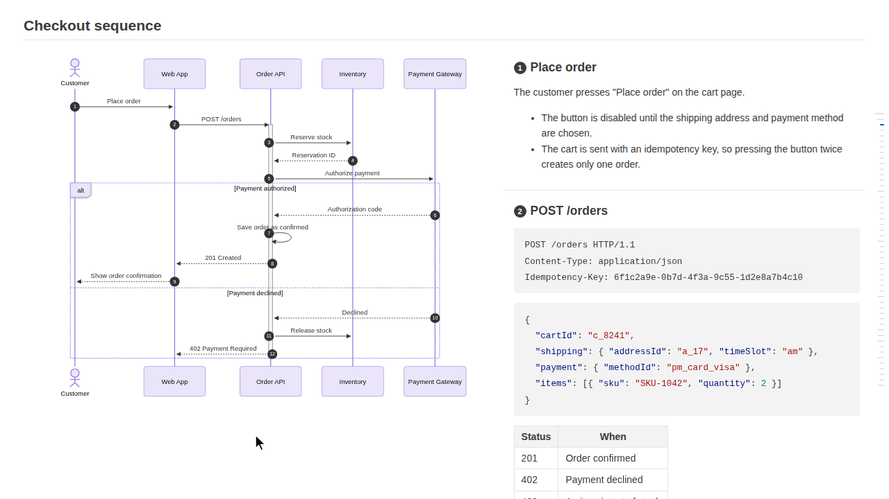

# markdown-design-doc-viewer-embed

[](https://www.npmjs.com/package/markdown-design-doc-viewer-embed)
[](https://github.com/playree/markdown-design-doc-viewer/blob/main/LICENSE)

English | [日本語](https://github.com/playree/markdown-design-doc-viewer/blob/main/docs/embed.ja.md)

The viewer of [Markdown Design Doc Viewer](https://github.com/playree/markdown-design-doc-viewer) as a component of a web app: it shows a design document written in Markdown in an element of your page, as the VS Code extension's preview does. **Mermaid sequence diagrams, flowcharts, ER diagrams and state diagrams are shown side by side with their step descriptions**, each arrow (or node) linked to its heading, and wireframes of screens linked to their item tables, with the table of contents, the document header of the front matter, and the light and dark themes.



## Install

```sh
npm install markdown-design-doc-viewer-embed mermaid
```

[mermaid](https://www.npmjs.com/package/mermaid) (`^12.3.0`) is a peer dependency (it draws the diagrams), and so are React and React DOM (`^19.3.1`) for the React component. The other libraries it uses (markdown-it, DOMPurify, highlight.js...) are bundled in it.

It is made of ES modules for the bundler of your app (Vite, webpack, Next.js, esbuild...).

## React

```tsx
import { DesignDocViewer } from 'markdown-design-doc-viewer-embed/react';
import 'markdown-design-doc-viewer-embed/viewer.css';

export function DesignDoc({ markdown }: { markdown: string }) {
  return <DesignDocViewer markdown={markdown} baseUrl="https://example.com/docs/" style={{ height: 600 }} />;
}
```

- **It needs a height**, which the viewer fills: it scrolls inside it.
- Its props are the options below, with `className` and `style` for its element.
- `readFile` and `resolveResource` render the document again when they change: keep them the same across renders (`useCallback`). The other callbacks may change freely.
- `lang` is read when the viewer is created: when it changes, the viewer is created again.
- Its `ref` has `scrollToLine(line)` and `markLine(line)` (`DesignDocViewerHandle`).
- `react.js` is a client component (`'use client'`), which the server components of Next.js can render: it shows the document in the browser.

## Without React

```ts
import { createViewer } from 'markdown-design-doc-viewer-embed';
import 'markdown-design-doc-viewer-embed/viewer.css';

const viewer = createViewer(element, { markdown, baseUrl: 'https://example.com/docs/' });
await viewer.ready; // the document is shown, with its diagrams
await viewer.update({ markdown: edited, theme: 'dark' }); // keeps the scrolling while documentId stays the same
viewer.destroy();
```

`createViewer(container, options)` adds the viewer into `container`, which needs a height. The `Viewer` it returns has:

| | |
| --- | --- |
| `ready` | Resolves once the document is shown, with its diagrams. |
| `update(options)` | Changes some options (all but `lang`) and renders the document again. Resolves once it is shown. |
| `scrollToLine(line)` | Scrolls the viewer so that this line (0-based) of the Markdown is at the top. |
| `markLine(line)` | Marks the element of this line (0-based), and scrolls it into view: e.g. the line of the cursor of an editor. |
| `destroy()` | Removes the viewer from its element. |

## Options

| Option | Default | |
| --- | --- | --- |
| `markdown` | (required) | The Markdown of the design document. |
| `documentId` | | Tells the documents apart: when it changes, the viewer shows another document, from its top. While it stays the same, an update keeps the scrolling, as when the document is edited. |
| `baseUrl` | | The URL of the folder of the document, from which the paths of its images and wireframes are resolved (and the wireframes read with `fetch`, without `readFile`). |
| `readFile` | `fetch` from `baseUrl` | `(path) => Promise<string \| undefined>`: reads a file of a wireframe (its HTML, or a style sheet of it), given its path as written in the document (relative to it, or to the root with a leading `/`), decoded. Returns undefined when it cannot be read. |
| `resolveResource` | resolved from `baseUrl` | `(src) => string`: the URL of an image `src` of the document. |
| `lang` | that of the browser | `'en'` or `'ja'`: the language of the texts of the viewer. Only read when the viewer is created. |
| `theme` | `'auto'` | `'light'`, `'dark'`, or those of the system (`'auto'`). |
| `diagramLook` | `'neo'` | `'neo'` or `'classic'` (flat) diagrams. |
| `splitMinWidth` | `1000` | The width (px) of the viewer from which the diagrams and their steps are side by side. |
| `toc` | `true` | The table of contents at the right. |
| `limitContentWidth` | `true` | Limits the width of the document. |
| `stickyTableHeader` | `true` | Keeps the header row of a long table at the top while it scrolls. |
| `tableTreeHighlight` | `true` | Highlights the parent and children of a row of a table shown as a tree. |
| `frontMatter` | `true` | Shows the front matter (as the header of a design document, or as a table). |
| `headingNumbers` | `true` | Shows the `autonumber` numbers on the linked headings. |
| `messageWrapWidth` | `30` | Breaks the labels of the arrows of the sequence diagrams into lines at this many characters (a full-width one counts as 2). `0` does not break them. |
| `onOpenLink` | `openLinkInNewTab` | `(href) => void`: opens a link of the document (other than `#heading`, which the viewer scrolls to). By default, http(s) and mailto links open in a new tab, and the others do nothing. |
| `onRevealLine` | | `(line) => void`: called with the line (0-based) of the Markdown double-clicked in the viewer, e.g. to show it in an editor. Without it, a double-click does nothing. |

## Styles

`viewer.css` has the styles of the viewer, all under its element (`.seqnotes-viewer`), with the colors of its light and dark themes. Import it as is, **not in a cascade layer** (such as `@import "…" layer(components)`): the styles of the elements of the document (headings, lists, tables...) have no specificity (`:where()`), and the viewer gives back the defaults of the browser that a CSS reset in a layer takes away (such as the preflight of Tailwind CSS v4, in its layer `base`): they win over it because they are not in a layer. The global styles of your page for elements outside a layer (`h1 { … }`, or a reset such as Tailwind CSS v3's preflight or normalize.css) still apply in the viewer.

## Server-side rendering

The modules can be imported on a server (Next.js, for instance): they use the document and the window only when a viewer is created. `DesignDocViewer` creates it in an effect, in the browser.

## Limitations

- The configuration of mermaid is global: the viewers of a page render their diagrams one after another, and the viewer initializes mermaid with its own settings. mermaid adds hooks to its DOMPurify.
- The `@font-face` rules of wireframes are added to the page (`document.adoptedStyleSheets`), since fonts are not loaded in a shadow root otherwise.
- The zoomed diagrams and the popups of the footnotes are over the whole page (`position: fixed`).
- Images are resolved synchronously (`resolveResource`): read them from URLs.
- The differences from a revision (the extension's Git comparison) are not shown.

## Writing linked documents

A diagram is linked to the headings after it with `%% @link-headings` in the diagram; arrows and nodes are matched with the headings by their text, or with `%% @ref`. See [Writing linked documents](https://github.com/playree/markdown-design-doc-viewer#writing-linked-documents) for the syntax, and [Wireframes](https://github.com/playree/markdown-design-doc-viewer#wireframes) for screens.

## License

[MIT](https://github.com/playree/markdown-design-doc-viewer/blob/main/LICENSE). The licenses of the bundled libraries are in ThirdPartyNotices.txt.
