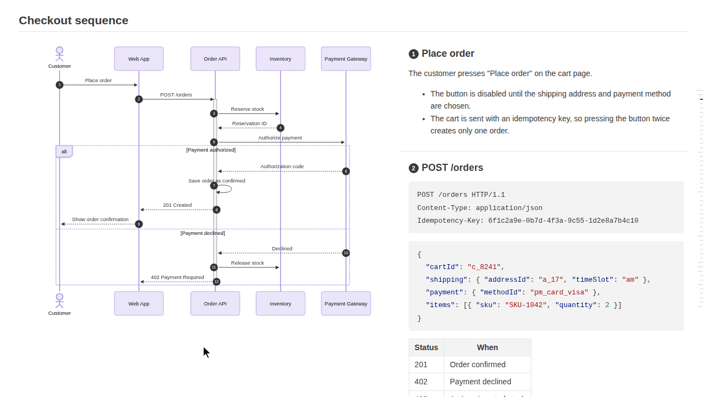

# markdown-design-doc-viewer-embed

[](https://www.npmjs.com/package/markdown-design-doc-viewer-embed)
[](https://github.com/playree/markdown-design-doc-viewer/blob/main/LICENSE)

English | [日本語](https://github.com/playree/markdown-design-doc-viewer/blob/main/docs/embed.ja.md)

The viewer of [Markdown Design Doc Viewer](https://github.com/playree/markdown-design-doc-viewer) as a component of a web app: it shows a design document written in Markdown in an element of your page, as the VS Code extension's preview does. **Mermaid sequence diagrams, flowcharts, ER diagrams and state diagrams are shown side by side with their step descriptions**, each arrow (or node) linked to its heading, and wireframes of screens linked to their item tables, with the table of contents, the document header of the front matter, and the light and dark themes. It can also export the document to a single HTML file, as the extension does ([Exporting to an HTML file](#exporting-to-an-html-file)).



## Install

```sh
npm install markdown-design-doc-viewer-embed mermaid
```

[mermaid](https://www.npmjs.com/package/mermaid) (`^12.3.0`) is a peer dependency (it draws the diagrams), and so are React and React DOM (`^19.3.1`) for the React component. The other libraries it uses (markdown-it, DOMPurify, highlight.js...) are bundled in it.

It is made of ES modules for the bundler of your app (Vite, webpack, Next.js, esbuild...).

## React

```tsx
import { DesignDocViewer } from 'markdown-design-doc-viewer-embed/react';
import 'markdown-design-doc-viewer-embed/viewer.css';

export function DesignDoc({ markdown }: { markdown: string }) {
  return <DesignDocViewer markdown={markdown} baseUrl="https://example.com/docs/" style={{ height: 600 }} />;
}
```

- **It needs a height**, which the viewer fills: it scrolls inside it.
- Its props are the options below, with `className` and `style` for its element.
- `readFile` and `resolveResource` render the document again when they change: keep them the same across renders (`useCallback`). The other callbacks may change freely.
- `lang` is read when the viewer is created: when it changes, the viewer is created again.
- Its `ref` has `scrollToLine(line)` and `markLine(line)` (`DesignDocViewerHandle`).
- `react.js` is a client component (`'use client'`), which the server components of Next.js can render: it shows the document in the browser.

## Without React

```ts
import { createViewer } from 'markdown-design-doc-viewer-embed';
import 'markdown-design-doc-viewer-embed/viewer.css';

const viewer = createViewer(element, { markdown, baseUrl: 'https://example.com/docs/' });
await viewer.ready; // the document is shown, with its diagrams
await viewer.update({ markdown: edited, theme: 'dark' }); // keeps the scrolling while documentId stays the same
viewer.destroy();
```

`createViewer(container, options)` adds the viewer into `container`, which needs a height. The `Viewer` it returns has:

| | |
| --- | --- |
| `ready` | Resolves once the document is shown, with its diagrams. |
| `update(options)` | Changes some options (all but `lang`) and renders the document again. Resolves once it is shown. |
| `scrollToLine(line)` | Scrolls the viewer so that this line (0-based) of the Markdown is at the top. |
| `markLine(line)` | Marks the element of this line (0-based), and scrolls it into view: e.g. the line of the cursor of an editor. |
| `destroy()` | Removes the viewer from its element. |

## Options

| Option | Default | |
| --- | --- | --- |
| `markdown` | (required) | The Markdown of the design document. |
| `documentId` | | Tells the documents apart: when it changes, the viewer shows another document, from its top. While it stays the same, an update keeps the scrolling, as when the document is edited. |
| `baseUrl` | | The URL of the folder of the document, from which the paths of its images and wireframes are resolved (and the wireframes read with `fetch`, without `readFile`). |
| `readFile` | `fetch` from `baseUrl` | `(path) => Promise<string \| undefined>`: reads a file of a wireframe (its HTML, or a style sheet of it), given its path as written in the document (relative to it, or to the root with a leading `/`), decoded. Returns undefined when it cannot be read. |
| `resolveResource` | resolved from `baseUrl` | `(src) => string`: the URL of an image `src` of the document. |
| `lang` | that of the browser | `'en'` or `'ja'`: the language of the texts of the viewer. Only read when the viewer is created. |
| `theme` | `'auto'` | `'light'`, `'dark'`, or those of the system (`'auto'`). |
| `diagramLook` | `'neo'` | `'neo'` or `'classic'` (flat) diagrams. |
| `splitMinWidth` | `1000` | The width (px) of the viewer from which the diagrams and their steps are side by side. |
| `toc` | `true` | The table of contents at the right. |
| `limitContentWidth` | `true` | Limits the width of the document. |
| `stickyTableHeader` | `true` | Keeps the header row of a long table at the top while it scrolls. |
| `tableTreeHighlight` | `true` | Highlights the parent and children of a row of a table shown as a tree. |
| `frontMatter` | `true` | Shows the front matter (as the header of a design document, or as a table). |
| `headingNumbers` | `true` | Shows the `autonumber` numbers on the linked headings. |
| `messageWrapWidth` | `40` | Breaks the labels of the arrows of the sequence diagrams into lines at this many characters (a full-width one counts as 2). `0` does not break them. |
| `restrictHtml` | `false` | Restricts the raw HTML of the document to what does not reach the page around the viewer, for documents written by others than the user of the app. It leaves out `<style>`, `<link>`, `<meta>` and `<base>`; forms (`<form>`, `<textarea>`, `<select>`, and the `<input>` and `<button>` other than the checkboxes of the task lists and the buttons of the tables); image maps (`<map>`, `<area>`); `<dialog>`; and the attributes `popover`, `autofocus`, `tabindex`, `for`, `usemap`, `form` and `name`. Of the `style` attributes, only the alignment of the table cells is kept, and of the `class` attributes, only the classes of the viewer (the styles of the page apply to the classes in the viewer, such as `fixed` of Tailwind CSS). The other `id`s start with `sn-`, as those of the headings, so that they are not those of the page (a `#id` link still finds them). The `@font-face` and `@property` rules of the wireframes are not added to the page (their fonts are not loaded), and their `:host` rules are left out. |
| `onOpenLink` | `openLinkInNewTab` | `(href) => void`: opens a link of the document (other than `#heading`, which the viewer scrolls to). By default, http(s) and mailto links open in a new tab, and the others do nothing. |
| `onRevealLine` | | `(line) => void`: called with the line (0-based) of the Markdown double-clicked in the viewer, e.g. to show it in an editor. Without it, a double-click does nothing. |
| `compareWith` | | The Markdown of another version of the document (an older one, for instance): the viewer shows `markdown` with its differences from it ([Showing the differences from a version](#showing-the-differences-from-a-version)). Without it, the document alone. |
| `compareLabel` | | What the document is compared with (e.g. `Compared with version 3 (2026-11-01)`), shown on the bar of the differences. |
| `onCloseDiff` | | `() => void`: called when the bar of the differences is closed (its × button), e.g. to remove `compareWith`. Without it, the viewer shows the document alone until `compareWith` changes. |

## Showing the differences from a version

```tsx
<DesignDocViewer
  markdown={latest}
  compareWith={compared?.markdown}
  compareLabel={compared ? `Compared with version ${compared.version}` : undefined}
  onCloseDiff={() => setCompared(undefined)}
  style={{ height: 600 }}
/>
```

With `compareWith`, the Markdown of another version of the document, the viewer shows `markdown` with its differences from that version, the same as the comparison with a Git revision of the extension: the blocks added, changed and deleted are marked, with the words changed in a changed block, the diagram before the change under a changed diagram (folded), and a bar at the bottom with what it is compared with (`compareLabel`), the number of blocks changed, and buttons to go from one change to the next. To see the changes of a newer version from an older one, give the newer one as `markdown` and the older one as `compareWith`.

- Without `compareWith` (or with `undefined`), the document is shown alone again.
- The × button of the bar calls `onCloseDiff`, with which the app removes `compareWith`. Without `onCloseDiff`, the viewer shows the document alone by itself, until `compareWith` changes.
- The files of the wireframes are those of the document: they are not compared.
- `exportHtml` takes `compareWith` and `compareLabel` too: the exported file shows the differences, with a bar that hides and shows them.

## Listing design documents

```tsx
import { DesignDocList } from 'markdown-design-doc-viewer-embed/react';

<DesignDocList
  documents={[
    { markdown: loginMarkdown, href: '/docs/login', file: 'login.md' },
    { markdown: frontMatterOnly, href: '/docs/screens/top', folder: 'screens', file: 'top.md' },
  ]}
  onOpenLink={(href) => router.push(href)}
/>
```

`DesignDocList` (`createDesignDocList(container, options)` without React) shows a list of design documents, the same as the list of the design docs of the extension and the desktop app: a table for each folder, with the title and file name of each document and the version, product, status and updated date of its front matter (the columns that a document has), a search box and sortable columns. Unlike the viewer, it does not need a height: it is as high as the list. `createDesignDocList` returns `ready`, `update(options)` (which keeps the search and the order) and `destroy()`.

- `markdown` of a document is its Markdown, or only its front matter: its title and entries are read from it as the viewer does.
- `documents` shows the list again when it changes: keep it the same across renders while it does not change (`useMemo`).

| Option | Default | |
| --- | --- | --- |
| `documents` | (required) | `{ markdown, href, folder?, file?, title? }[]`: the documents. `href` is the link of the title. `folder` (with `/` between folders, `''` at the top) gives a table and a heading to each folder. `file` is shown next to the title. `title` replaces that of the Markdown (the `title` of its front matter, its first `#` heading, `file`, or `href`). |
| `title` | `Design Docs` | The heading of the list. |
| `fileLabel` | `File` | The header of the column of `file` (e.g. the number of a page). |
| `filterPlaceholder` | | The placeholder of the search box. By default, it names the title, the file name and the metadata. |
| `empty` | | The text without documents. By default, the one of the extension. |
| `keepOrder` | `false` | Lists the folders and the documents in the order of `documents` (a folder where its first document is), instead of by name. |
| `lang`, `theme`, `limitContentWidth` | as the viewer | The same as the options of the viewer ([Options](#options)). |
| `onOpenLink` | `openLinkInPage` | `(href) => void`: opens the link of a title. By default, goes to it in the page (except `javascript:`, `data:` and `vbscript:` links). A link that starts with `#` scrolls the list to that fragment instead. |

## Exporting to an HTML file

```ts
const { exportHtml } = await import('markdown-design-doc-viewer-embed/export');

const html = await exportHtml({
  markdown,
  lang: 'en',
  title: 'Design doc', // when the document has no title of its own
  resolveImage: async (path) => toDataUri(path), // embeds the images in the file
});
// e.g. downloaded as a file
const link = document.createElement('a');
link.href = URL.createObjectURL(new Blob([html], { type: 'text/html' }));
link.download = 'design-doc.html';
link.click();
setTimeout(() => URL.revokeObjectURL(link.href), 1000);
```

`exportHtml(options)` resolves with a single HTML file of the design document, as a string: the same file as the extension's **Export Design Doc as HTML** and the command line's `md-design-doc export`. Its styles and script are in it, so that it works on its own: the table of contents, the diagrams side by side with their steps, the highlighting of the arrows and steps, and the diagrams above their steps when it is printed. It has the light theme, without the warnings and the marks of missing links.

- The diagrams are rendered in your page, by the browser, as the viewer does: import `viewer.css` (as for the viewer), with which they are measured. The viewers of the page keep their colors: the renders of mermaid wait for one another.
- A diagram that cannot be rendered is in the file with its error, as in the viewer: `exportHtml` still resolves.
- `export.js` has the styles and script of the exported file, which the viewer (`index.js`) does not carry: import it when it is needed (`import()`).

| Option | Default | |
| --- | --- | --- |
| `markdown` | (required) | The Markdown of the design document. |
| `title` | | The title of the page when the document has none (neither `title` in its front matter nor a `#` heading). |
| `resolveImage` | resolved from `baseUrl` | `(path) => string \| Promise<string>`: what an image of the document (a path, not a URL) becomes in the file: a data URI that embeds it, or a URL that links it. It is given the `src` of the image without its query and fragment (`icons.svg` of `icons.svg#save`), which are added back to a URL. When it fails, the `src` is kept. |
| `baseUrl`, `readFile` | | As for the viewer: the files of the wireframes, and the images without `resolveImage`. |
| `lang` | that of the browser | `'en'` or `'ja'`: the language of the texts of the file. |
| `restrictHtml` | `false` | As for the viewer: the raw HTML of the document is restricted in the exported file too. |
| `compareWith`, `compareLabel` | | As for the viewer: the exported file shows the differences from `compareWith`, with a bar that hides and shows them. |
| `diagramLook`, `splitMinWidth`, `toc`, `limitContentWidth`, `stickyTableHeader`, `tableTreeHighlight`, `frontMatter`, `headingNumbers`, `messageWrapWidth` | as for the viewer | As for the viewer (see [Options](#options)), for the exported file. |

## Styles

`viewer.css` has the styles of the viewer, all under its element (`.seqnotes-viewer`), with the colors of its light and dark themes. Import it as is, **not in a cascade layer** (such as `@import "…" layer(components)`): the styles of the elements of the document (headings, lists, tables...) have no specificity (`:where()`), and the viewer gives back the defaults of the browser that a CSS reset in a layer takes away (such as the preflight of Tailwind CSS v4, in its layer `base`): they win over it because they are not in a layer. The global styles of your page for elements outside a layer (`h1 { … }`, or a reset such as Tailwind CSS v3's preflight or normalize.css) still apply in the viewer.

## Server-side rendering

The modules can be imported on a server (Next.js, for instance): they use the document and the window only when a viewer is created (or a document exported). `DesignDocViewer` creates it in an effect, in the browser.

## Limitations

- The configuration of mermaid is global: the viewers of a page render their diagrams one after another, and the viewer initializes mermaid with its own settings. mermaid adds hooks to its DOMPurify.
- The `@font-face` rules of wireframes are added to the page (`document.adoptedStyleSheets`), since fonts are not loaded in a shadow root otherwise. They stay there after the viewer is removed. A viewer with `restrictHtml` does not add them, but does not remove those added before (by another viewer, or before `restrictHtml` was set).
- The raw HTML of the document is part of the page (without a shadow root): the global styles of the page (on elements such as `h1`, or on classes and ids) apply to it, and its `id`s are among those of the page. `restrictHtml` keeps it from styling the page and from reaching its elements, not from being styled by the page.
- The links of the document (`<a href>` and `<area href>`, clicked with the left or middle button) go to `onOpenLink`, and its forms are not submitted, with or without `restrictHtml`.
- The zoomed diagrams and the popups of the footnotes are over the whole page (`position: fixed`).
- Images are resolved synchronously (`resolveResource`): read them from URLs.

## Writing linked documents

A diagram is linked to the headings after it with `%% @link-headings` in the diagram; arrows and nodes are matched with the headings by their text, or with `%% @ref`. See [Writing linked documents](https://github.com/playree/markdown-design-doc-viewer#writing-linked-documents) for the syntax, and [Wireframes](https://github.com/playree/markdown-design-doc-viewer#wireframes) for screens.

## Agent Skill

The package also has the [Agent Skill](https://agentskills.io/) that teaches AI assistants to write these documents (the same as [markdown-design-doc-skill.zip](https://github.com/playree/markdown-design-doc-viewer/releases/latest/download/markdown-design-doc-skill.zip) of the release of this version), for an app that installs it without a network, such as an MCP server. It can be imported in Node:

```ts
import { agentSkill } from 'markdown-design-doc-viewer-embed/skill';

// agentSkill.name: 'markdown-design-doc', the name of its folder in a skills folder (such as ~/.claude/skills/)
// agentSkill.files: { 'SKILL.md': '…', 'references/cli.md': '…' }, by their paths in that folder
// agentSkill.revision: raised each time the files change
```

To install it, write its files into the folder `markdown-design-doc` of the skills folder. The revision is also in the front matter of its SKILL.md (`metadata.revision`): a copy already there with a lower one (or none) is older, and one with a higher one is newer, so do not replace it.

## License

[MIT](https://github.com/playree/markdown-design-doc-viewer/blob/main/LICENSE). The licenses of the bundled libraries are in ThirdPartyNotices.txt.
