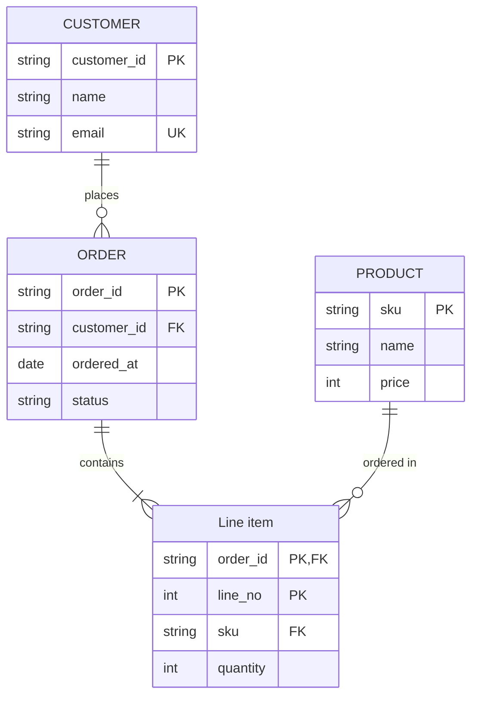

# Order Database Design

ER diagrams are linked to their headings like flowcharts: each entity is linked to the heading with the same text as its alias, or as its name when it has no alias.

## Tables

### CUSTOMER

A person or a company that places orders. The email is unique, as it is used to sign in.

<!-- table: merge=Column,Type -->
| Column | Type | Key | Description |
|---|---|---|---|
| customer_id | string | PK | Issued at sign-up. |
| name | string | | |
| email | string | UK | |

### ORDER

One checkout of a customer.

| Column | Type | Key | Description |
|---|---|---|---|
| order_id | string | PK | |
| customer_id | string | FK | `CUSTOMER.customer_id` |
| ordered_at | date | | |
| status | string | | `pending`, `paid`, `shipped` or `cancelled` |

### Order lines

Linked to the entity "Line item" by `%% @ref`. One line per product of an order.

| Column | Type | Key | Description |
|---|---|---|---|
| order_id | string | PK, FK | `ORDER.order_id` |
| line_no | int | PK | From 1 in each order. |
| sku | string | FK | `PRODUCT.sku` |
| quantity | int | | 1 or more. |

### PRODUCT

An item on sale. The price includes the tax.

| Column | Type | Key | Description |
|---|---|---|---|
| sku | string | PK | |
| name | string | | |
| price | int | | |

<!-- link-headings:end -->

## Notes

The headings after the end marker are not linked to the diagram.
