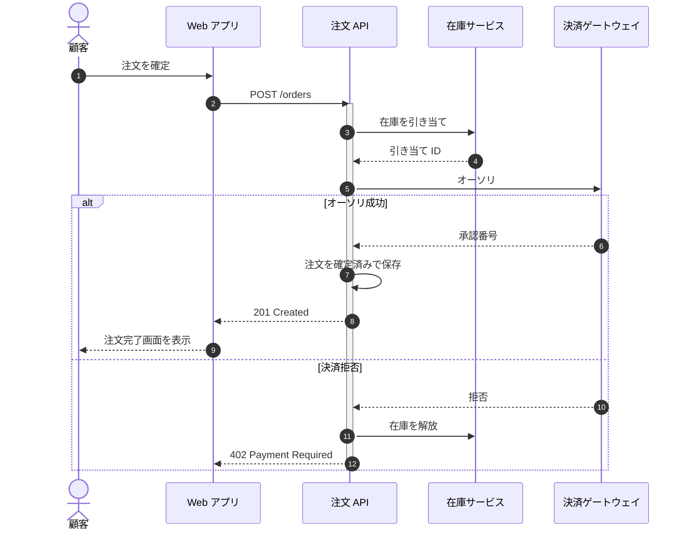
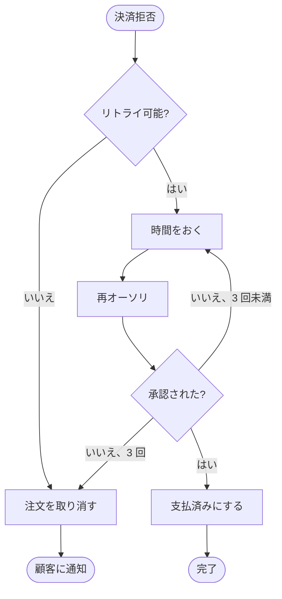
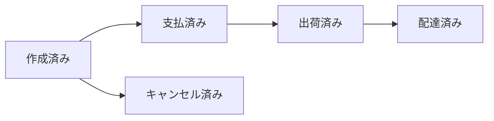
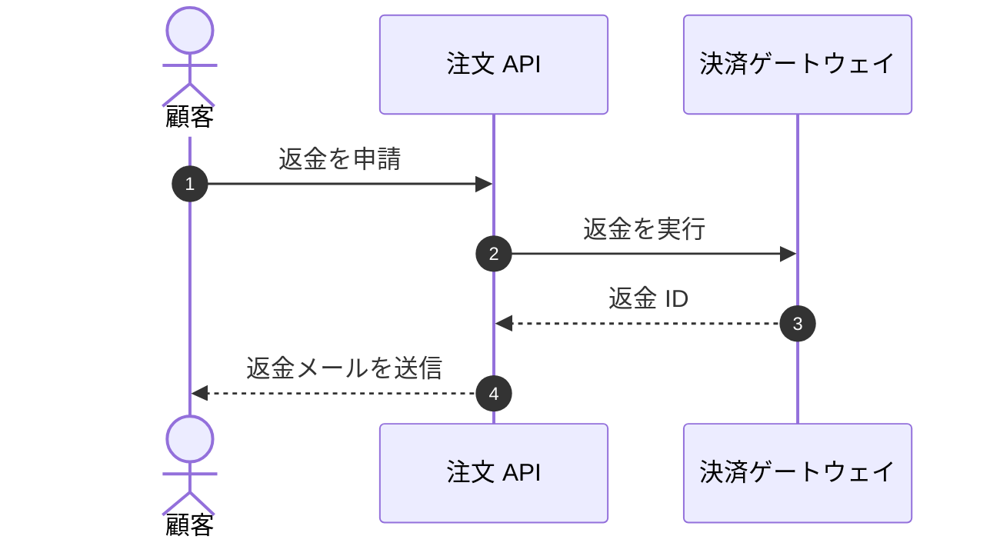

# 注文確定 設計書

> [!NOTE]
> この設計書では、カート画面の「注文を確定」ボタンから注文完了までの流れを説明する。配送と請求は別の設計書で説明する。

## 注文確定のシーケンス



### 1. 注文を確定

顧客がカート画面で「注文を確定」を押す。

- 配送先と支払い方法を選ぶまで、ボタンは押せない。
- カートは冪等キーを付けて送るので、ボタンを 2 回押しても注文は 1 件しかできない。

### 2. POST /orders

```http
POST /orders HTTP/1.1
Content-Type: application/json
Idempotency-Key: 6f1c2a9e-0b7d-4f3a-9c55-1d2e8a7b4c10
```

```json
{
  "cartId": "c_8241",
  "shipping": { "addressId": "a_17", "timeSlot": "am" },
  "payment": { "methodId": "pm_card_visa" },
  "items": [{ "sku": "SKU-1042", "quantity": 2 }]
}
```

| ステータス | 条件 |
|---|---|
| 201 | 注文確定 |
| 402 | 決済拒否 |
| 409 | 在庫切れの商品がある |

### 3. 在庫を引き当て

カートのすべての商品を 1 つのトランザクションで引き当てる。1 つでも足りなければ何も引き当てず、`409 Conflict` を返す。

```sql
UPDATE stock
SET reserved = reserved + $2
WHERE sku = $1 AND quantity - reserved >= $2;
```

### 引き当て ID

注文が確定しなければ、引き当ては 15 分で失効する[^expiry]。

### 5. オーソリ

注文金額をオーソリする。売上の確定は出荷時に行う。

> [!IMPORTANT]
> カード番号は注文 API に送らない。Web アプリが決済ゲートウェイに直接送り、返された `payment.methodId` だけを渡す。

### 承認番号

注文と一緒に保存し、出荷時の売上確定に使う。

### 注文を確定済みにする

注文をステータス `confirmed` で保存し、引き当てを注文に紐付ける。

```typescript
export async function confirmOrder(tx: Tx, order: NewOrder, auth: Authorization): Promise<Order> {
  const saved = await tx.orders.insert({ ...order, status: 'confirmed', authCode: auth.code });
  await tx.reservations.attach(order.reservationId, saved.id);
  return saved;
}
```

### 201 Created

注文 ID とお届け予定日を返す。

### 9. 注文完了画面を表示

注文番号を表示し、注文確認メールを送る。

- [x] 注文番号と商品
- [x] お届け予定日
- [ ] 30 分以内のキャンセルへのリンク

### 拒否

ゲートウェイが拒否コードを返す。リトライするコードは[決済リトライのフロー](#決済リトライのフロー)を参照。

### 在庫を解放

他の顧客が買えるよう、引き当てをすぐに解放する。

### 402 Payment Required

> [!WARNING]
> 拒否コードは顧客に見せない。「お支払いを完了できませんでした。」と表示し、別の支払い方法を選べるようにする。

<!-- link-headings:end -->

## 決済リトライのフロー



### 決済拒否

定期購入の更新など、バッチ処理が始めたオーソリをゲートウェイが拒否したときに始まる。

### リトライ可能?

| 拒否コード | リトライ |
|---|---|
| `processing_error` | する |
| `try_again_later` | する |
| `insufficient_funds` | しない |
| `card_declined` | しない |

### 時間をおく

1 分、5 分、30 分と待つ。

### 再オーソリ

最初と同じ冪等キーを使う。

### 承認された?

再試行したオーソリの結果を確かめる。

### 決済を完了

注文のステータスを `paid` にする。

### 注文を取り消す

在庫を解放し、注文を取り消す。

### 完了

注文は出荷に進む。

### 顧客に通知

支払い方法の更新をお願いするメールを送る。

<!-- link-headings:end -->

## 注文のステータス



### 作成済み

注文を保存し、支払いを待っている。

### 支払済み

オーソリが承認された。

### 出荷済み

配送業者に荷物を渡した。この時点で売上を確定する。

### 配達済み

配送業者から配達完了の連絡があった。

### キャンセル済み

出荷前に注文がキャンセルされた。オーソリは取り消す。

<!-- link-headings:end -->

## エラーコード

注文 API のエラー。エラーのレスポンスの本文は `{ "code": "ORD-011", "message": "..." }`。

| コード | HTTP ステータス | 意味 | クライアントの対応 |
|---|---|---|---|
| `ORD-001` | 400 | リクエストの本文が JSON として正しくない。 | リクエストを直す。 |
| `ORD-002` | 400 | 必須の項目がない。 | リクエストを直す。 |
| `ORD-003` | 400 | `Idempotency-Key` ヘッダがない。 | ヘッダを付ける。 |
| `ORD-004` | 400 | `quantity` が正の整数でない。 | リクエストを直す。 |
| `ORD-005` | 400 | 1 回の注文の商品が多すぎる（最大 100）。 | 注文を分ける。 |
| `ORD-006` | 401 | アクセストークンがないか、期限切れ。 | ログインし直す。 |
| `ORD-007` | 402 | 決済が拒否された。 | 別の支払い方法を選んでもらう。 |
| `ORD-008` | 402 | カードの有効期限が切れている。 | 別のカードを選んでもらう。 |
| `ORD-009` | 402 | 3-D セキュアの認証に失敗した。 | 認証をやり直す。 |
| `ORD-010` | 403 | アカウントが停止されている。 | 問い合わせ先を表示する。 |
| `ORD-011` | 404 | カートが存在しない。 | カートを読み直す。 |
| `ORD-012` | 404 | 配送先が存在しない。 | 配送先を選び直してもらう。 |
| `ORD-013` | 404 | 支払い方法が存在しない。 | 支払い方法を選び直してもらう。 |
| `ORD-014` | 409 | 在庫切れの商品がある。 | 在庫数を表示して選び直してもらう。 |
| `ORD-015` | 409 | 注文確定の途中でカートが変わった。 | 新しいカートを表示する。 |
| `ORD-016` | 409 | `Idempotency-Key` が別のカートで使われている。 | 新しいキーを作る。 |
| `ORD-017` | 422 | 配送先が配送エリアの外にある。 | 別の配送先を選んでもらう。 |
| `ORD-018` | 422 | 合計金額が最低注文金額に満たない。 | 最低注文金額を表示する。 |
| `ORD-019` | 429 | リクエストが多すぎる。 | `Retry-After` の後にリトライする。 |
| `ORD-020` | 502 | 決済ゲートウェイが応答しなかった。 | 注文一覧を確かめてからリトライする。 |
| `ORD-021` | 503 | 在庫サービスが利用できない。 | 時間をおいてリトライする。 |

## POST /orders のリクエスト本文

JSON の本文の項目。子の項目の「必須」は、親を送るときに必須かを表す。

<!-- table: level=階層 merge=項目名,物理名 -->
| No | 階層 | 項目名 | 物理名 | 型 | 必須 | 説明 |
|---|---|---|---|---|---|---|
| 1 | 1 | カート ID | `cartId` | string | ○ | 注文するカート |
| 2 | 1 | 配送 | `shipping` | object | ○ | |
| 3 | 2 | 配送先 ID | `addressId` | string | ○ | 顧客の登録済みの住所 |
| 4 | 2 | 配達日 | `deliveryDate` | string | | `YYYY-MM-DD`。省略時は最短の日 |
| 5 | 2 | 時間帯 | `timeSlot` | string | | `am`・`pm`・`evening` |
| 6 | 1 | 支払い | `payment` | object | ○ | |
| 7 | 2 | 支払い方法 ID | `methodId` | string | ○ | 登録済みのカードやウォレット |
| 8 | 2 | クーポンコード | `couponCode` | string | | |
| 9 | 1 | 商品 | `items` | array | ○ | 1〜100 件 |
| 10 | 2 | SKU | `sku` | string | ○ | |
| 11 | 2 | 数量 | `quantity` | integer | ○ | 1〜99 |
| 12 | 2 | ギフト包装 | `giftWrap` | boolean | | 省略時は `false` |

## 返金（草案）



### 返金を申請

返金はお届けから 30 日以内に申請できる。

### 返金を実行

確定した売上を元の支払い方法に返金する。

### 返金メールを送信

返金が反映されるまで最大 10 日かかることを顧客に伝える。

### 在庫に戻す

返品された商品を検品し、在庫に戻す。

<!-- link-headings:end -->

## 未決事項

- [ ] 一部返金に対応する
  - [x] 経理チームとルールを合意する
  - [ ] 返金の申請に金額を追加する
- [ ] 注文確定画面に引き当ての残り時間を表示する
- [x] すべての決済の呼び出しに冪等キーを使う[^idempotency]

> [!TIP]
> ローカルで注文確定を試すには、`docker compose up -d payment-mock` でゲートウェイのモックを起動し、カード `4242 4242 4242 4242` を使う。

<details>
<summary>なぜオーソリより先に在庫を引き当てるのか</summary>

先にオーソリしてから在庫が切れると、オーソリを取り消すことになり、銀行によっては数日間それが顧客に見えてしまう。

</details>

> [!CAUTION]
> 承認番号やカード番号は、一部であってもログに出さない。

[^expiry]: 数分かかることのある 3-D セキュアの認証に足りる長さにしている。失効した引き当ては、バッチが 1 分ごとに解放する。
[^idempotency]: ゲートウェイはキーを 24 時間保持する。それより後にリトライすると、二重に決済されてしまう。
