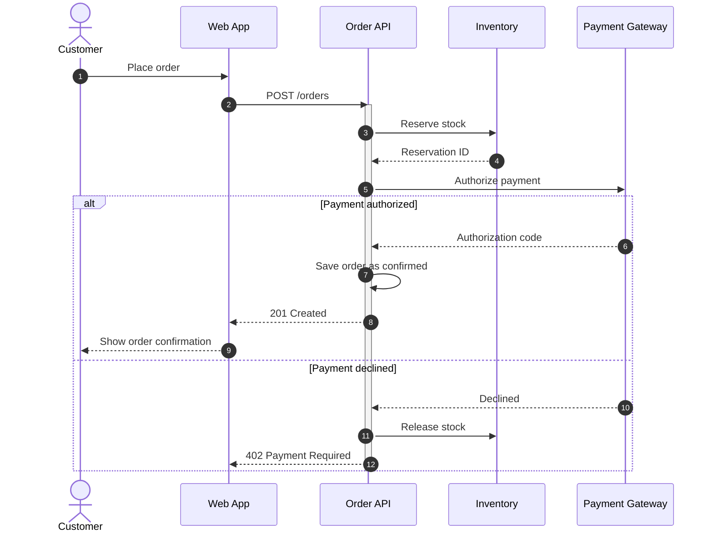
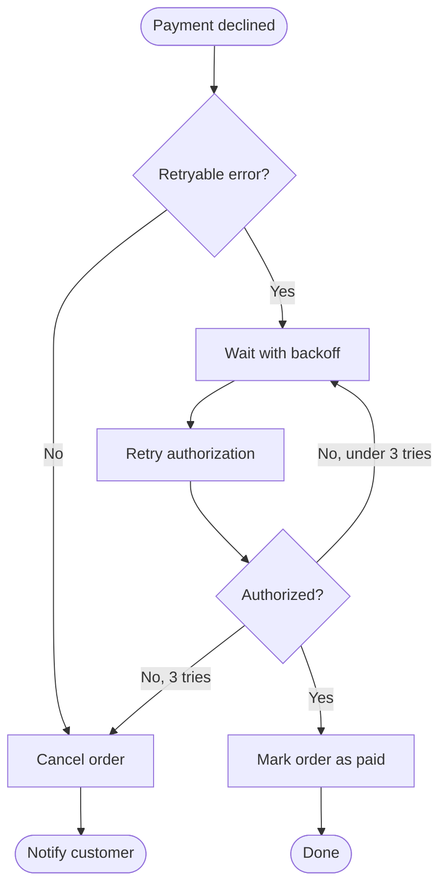
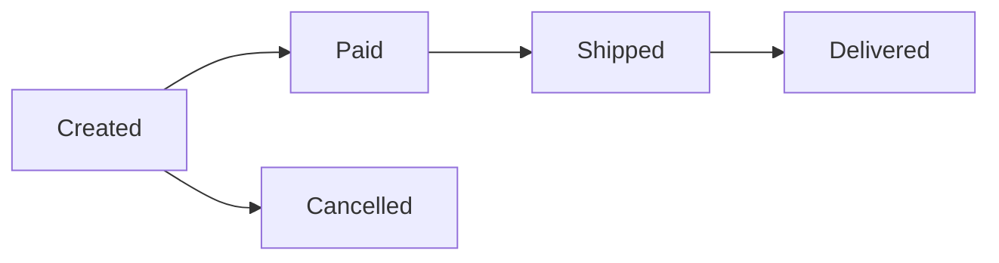
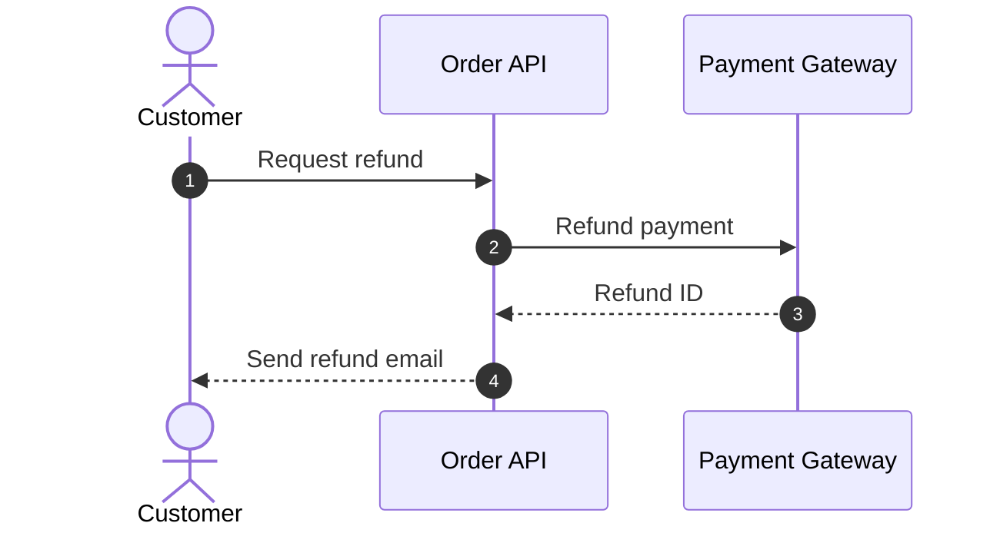

# Checkout Design

> [!NOTE]
> This document describes how an order is placed from the cart page, from the "Place order" button to the order confirmation. Shipping and invoicing are described in separate documents.

## Checkout sequence



### 1. Place order

The customer presses "Place order" on the cart page.

- The button is disabled until the shipping address and payment method are chosen.
- The cart is sent with an idempotency key, so pressing the button twice creates only one order.

### 2. POST /orders

```http
POST /orders HTTP/1.1
Content-Type: application/json
Idempotency-Key: 6f1c2a9e-0b7d-4f3a-9c55-1d2e8a7b4c10
```

```json
{
  "cartId": "c_8241",
  "shipping": { "addressId": "a_17", "timeSlot": "am" },
  "payment": { "methodId": "pm_card_visa" },
  "items": [{ "sku": "SKU-1042", "quantity": 2 }]
}
```

| Status | When |
|---|---|
| 201 | Order confirmed |
| 402 | Payment declined |
| 409 | An item is out of stock |

### 3. Reserve stock

Reserves every item of the cart in one transaction. If one item is short, nothing is reserved and the API returns `409 Conflict`.

```sql
UPDATE stock
SET reserved = reserved + $2
WHERE sku = $1 AND quantity - reserved >= $2;
```

### Reservation ID

The reservation expires after 15 minutes[^expiry] if the order is not confirmed.

### 5. Authorize payment

Authorizes the order total. The amount is captured later, when the order is shipped.

> [!IMPORTANT]
> Never send the card number to the Order API. The Web App sends it to the Payment Gateway directly and passes only the `payment.methodId` it gets back.

### Authorization code

Stored with the order and used to capture the payment at shipping.

### Confirm order

Saves the order with the status `confirmed` and links the reservation to it.

```typescript
export async function confirmOrder(tx: Tx, order: NewOrder, auth: Authorization): Promise<Order> {
  const saved = await tx.orders.insert({ ...order, status: 'confirmed', authCode: auth.code });
  await tx.reservations.attach(order.reservationId, saved.id);
  return saved;
}
```

### 201 Created

Returns the order ID and the expected delivery date.

### 9. Show order confirmation

Shows the order number and sends a confirmation email.

- [x] Order number and items
- [x] Expected delivery date
- [ ] Link to cancel within 30 minutes

### Declined

The gateway returns a decline code. See [Payment retry flow](#payment-retry-flow) for the codes that are retried.

### Release stock

Releases the reservation at once, so that other customers can buy the items.

### 402 Payment Required

> [!WARNING]
> Do not show the decline code to the customer. Show "Your payment could not be completed." and let them choose another payment method.

<!-- link-headings:end -->

## Payment retry flow



### Payment declined

The flow starts when the gateway declines an authorization that was started by a background job, such as a subscription renewal.

### Retryable error?

| Decline code | Retry |
|---|---|
| `processing_error` | Yes |
| `try_again_later` | Yes |
| `insufficient_funds` | No |
| `card_declined` | No |

### Wait with backoff

Waits 1 minute, 5 minutes, then 30 minutes.

### Retry authorization

Uses the same idempotency key as the first attempt.

### Authorized?

Checks the result of the retried authorization.

### Complete payment

Updates the order status to `paid`.

### Cancel order

Releases the stock and cancels the order.

### Done

The order continues to shipping.

### Notify customer

Sends an email asking the customer to update their payment method.

<!-- link-headings:end -->

## Order status



### Created

The order is saved and waits for payment.

### Paid

The payment was authorized.

### Shipped

The carrier has the parcel. The payment is captured at this point.

### Delivered

The carrier reported the delivery.

### Cancelled

The order was cancelled before shipping. The authorization is voided.

<!-- link-headings:end -->

## Error codes

The errors of the Order API. The body of an error response is `{ "code": "ORD-011", "message": "..." }`.

| Code | HTTP status | Meaning | Client action |
|---|---|---|---|
| `ORD-001` | 400 | The request body is not valid JSON. | Fix the request. |
| `ORD-002` | 400 | A required field is missing. | Fix the request. |
| `ORD-003` | 400 | The `Idempotency-Key` header is missing. | Add the header. |
| `ORD-004` | 400 | `quantity` is not a positive integer. | Fix the request. |
| `ORD-005` | 400 | Too many items in one order (max 100). | Split the order. |
| `ORD-006` | 401 | The access token is missing or has expired. | Log in again. |
| `ORD-007` | 402 | The payment was declined. | Ask for another payment method. |
| `ORD-008` | 402 | The card has expired. | Ask for another card. |
| `ORD-009` | 402 | The 3-D Secure check failed. | Retry the check. |
| `ORD-010` | 403 | The account is suspended. | Show the support contact. |
| `ORD-011` | 404 | The cart does not exist. | Reload the cart. |
| `ORD-012` | 404 | The shipping address does not exist. | Ask for an address again. |
| `ORD-013` | 404 | The payment method does not exist. | Ask for a payment method again. |
| `ORD-014` | 409 | An item is out of stock. | Show the stock and ask again. |
| `ORD-015` | 409 | The cart changed while checking out. | Show the new cart. |
| `ORD-016` | 409 | The `Idempotency-Key` was used for another cart. | Create a new key. |
| `ORD-017` | 422 | The address is outside the delivery area. | Ask for another address. |
| `ORD-018` | 422 | The total is below the minimum order. | Show the minimum. |
| `ORD-019` | 429 | Too many requests. | Retry after `Retry-After`. |
| `ORD-020` | 502 | The payment gateway did not answer. | Check the order list before retrying. |
| `ORD-021` | 503 | The inventory service is unavailable. | Retry later. |

## Request body of POST /orders

The fields of the JSON body. "Required" of a nested field applies when its parent is sent.

<!-- table: level=Level merge=Field,"Physical name" -->
| No | Level | Field | Physical name | Type | Required | Description |
|---|---|---|---|---|---|---|
| 1 | 1 | Cart ID | `cartId` | string | Yes | The cart to check out. It must belong to the signed-in customer and must not have been checked out already. |
| 2 | 1 | Shipping | `shipping` | object | Yes | |
| 3 | 2 | Address ID | `addressId` | string | Yes | One of the customer's saved addresses. An address outside the delivery area is rejected, so the order screen grays out the addresses that cannot be delivered to. |
| 4 | 2 | Delivery date | `deliveryDate` | string | | `YYYY-MM-DD`. The earliest date when omitted. A fully booked date or a date more than 14 days ahead is rejected. |
| 5 | 2 | Time slot | `timeSlot` | string | | `am`, `pm` or `evening`. Any time of the day when omitted. `evening` is not available on Sundays. |
| 6 | 1 | Payment | `payment` | object | Yes | |
| 7 | 2 | Payment method ID | `methodId` | string | Yes | A saved card or wallet. A card that has expired or failed the last authorization cannot be used until the customer updates it. |
| 8 | 2 | Coupon code | `couponCode` | string | | Only one coupon per order. An expired coupon is ignored, and the response tells why. |
| 9 | 1 | Items | `items` | array | Yes | 1 to 100 items. Each SKU appears only once; send the total in `quantity`. |
| 10 | 2 | SKU | `sku` | string | Yes | |
| 11 | 2 | Quantity | `quantity` | integer | Yes | 1 to 99. Also limited by the stock and by the per-customer limit of the product, whichever is smaller. |
| 12 | 2 | Gift wrap | `giftWrap` | boolean | | `false` when omitted. Wrapping is charged per item and is not available for some products such as furniture. |

## Order confirmation screen

The screen shown by step 9 of the checkout. The numbers of the wireframe are those of the items below.

<!-- wireframe: link-headings width=375 -->
[Order confirmation screen](screens/order-complete.html)

<!-- table: item=No merge=Item,Name -->
| No | Item | Name | Type | Description |
|---|---|---|---|---|
| 1 | Order number | `orderNo` | Text | From the response of `POST /orders`. |
| 2 | Items | `items` | List | One row per SKU, with its quantity and subtotal. |
| 3 | Total | `total` | Text | Tax and shipping included. |
| 4 | Delivery | `delivery` | Text | The date and time slot chosen. |
| 5 | Continue shopping | `continue` | Button | |
| 6 | View your orders | `orders` | Link | |

### 5. Continue shopping

Opens the top page. The cart is empty by now.

### 6. View your orders

Opens the order history, with this order at the top.

<!-- link-headings:end -->

## Refund (draft)



### Request refund

Refunds can be requested within 30 days of delivery.

### Refund payment

Refunds the captured amount to the original payment method.

### Send refund email

Tells the customer that the refund can take up to 10 days to appear.

### Restock items

Returned items are checked and added back to the stock.

<!-- link-headings:end -->

## Open items

- [ ] Support partial refunds
  - [x] Agree on the rules with the finance team
  - [ ] Add an amount to the refund request
- [ ] Show the reservation timer on the checkout page
- [x] Use idempotency keys for every payment call[^idempotency]

> [!TIP]
> To try the checkout locally, start the gateway mock with `docker compose up -d payment-mock` and use the card `4242 4242 4242 4242`.

<details>
<summary>Why reserve stock before authorizing the payment?</summary>

If the payment is authorized first and the stock then runs out, the authorization has to be voided, and some banks show it to the customer for several days.

</details>

> [!CAUTION]
> Never log the authorization code or any part of the card number.

[^expiry]: Long enough for a 3-D Secure check, which can take several minutes. A job releases the expired reservations every minute.
[^idempotency]: The gateway keeps a key for 24 hours. A retry after that would create a second payment.
