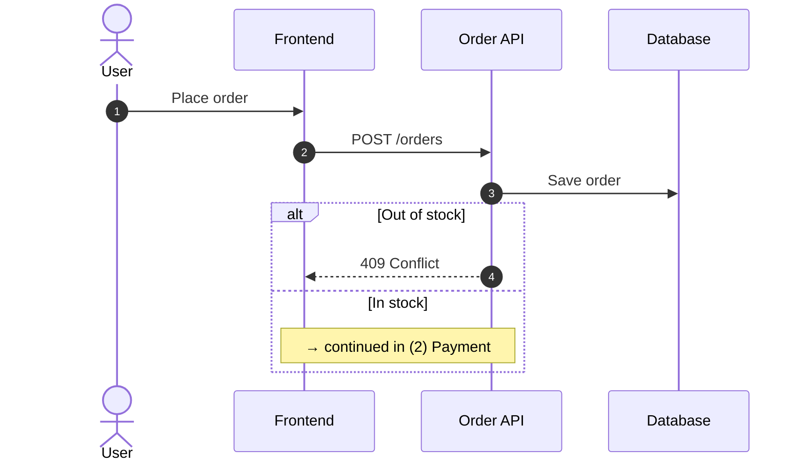
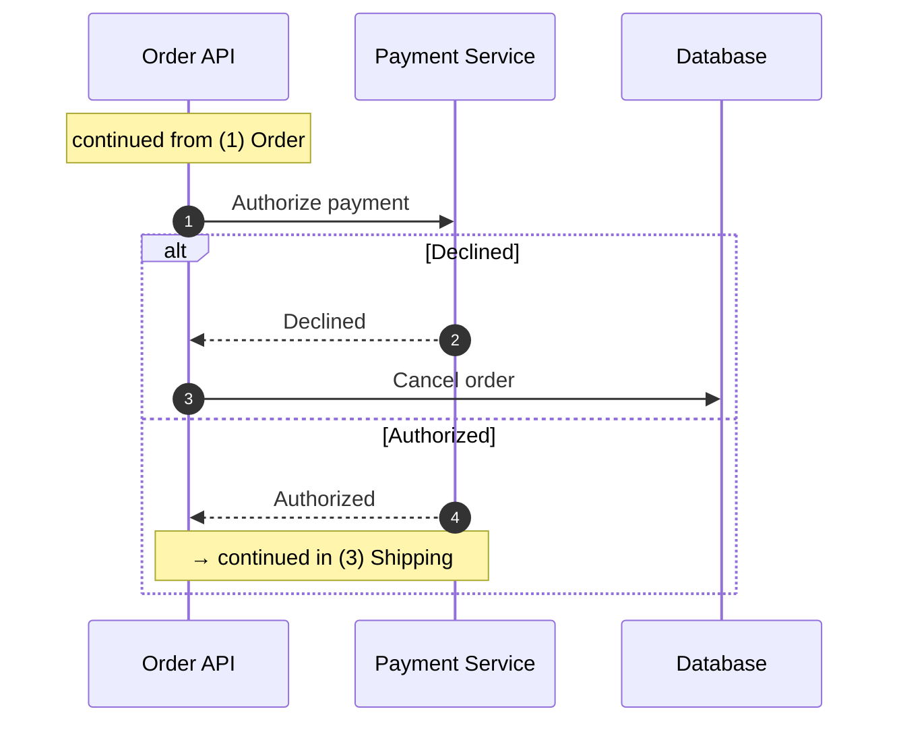
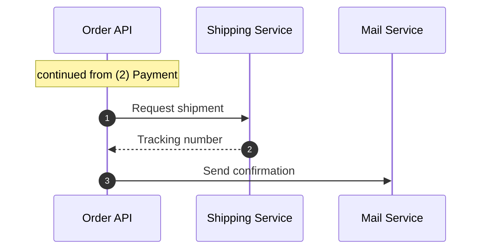

# Checkout Design

The checkout is too long for one sequence diagram, so it is split into three parts. A note at the end of each part jumps to the start of the next one (`%% @goto`), and the label at the start of a part (`%% @anchor`) goes back to it.

## (1) Order

### Place order

The user confirms the cart and places the order.

### POST /orders

The frontend sends the cart and the delivery address.

### Save order

The order is saved with the status `pending`. The stock is reserved in the same transaction.

### 409 Conflict

When an item is out of stock, the order is not saved and the items are returned to the frontend.

<!-- link-headings:end -->

## (2) Payment

### Authorize payment

The total of the order is authorized on the card of the user.

### Declined

The reason of the decline is shown to the user.

### Cancel order

The order is set to `canceled` and the reserved stock is released.

### Authorized

The authorization ID is saved with the order.

<!-- link-headings:end -->

## (3) Shipping

### Request shipment

The items and the delivery address are sent to the shipping service.

### Tracking number

The tracking number is saved with the order, whose status becomes `confirmed`.

### Send confirmation

A confirmation email with the tracking number is sent to the user.
