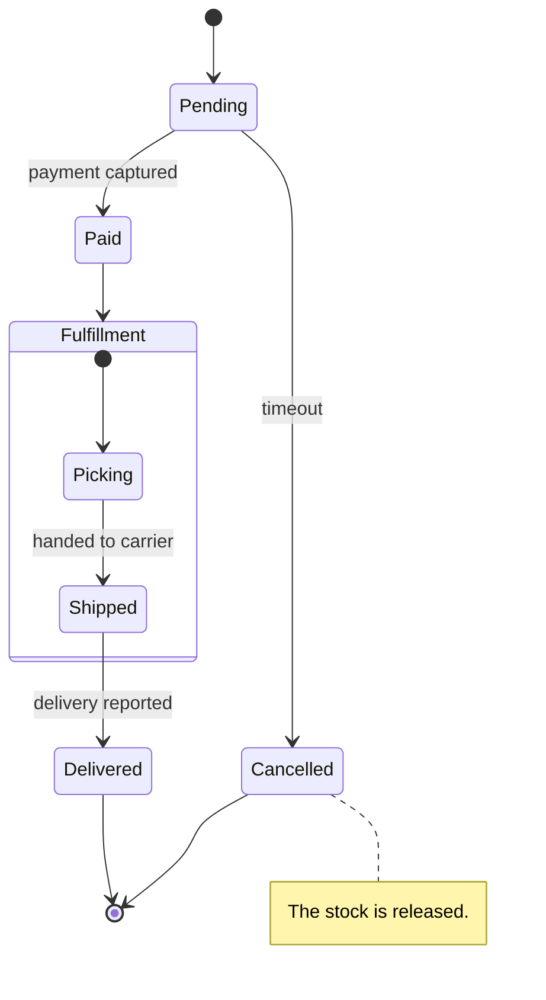
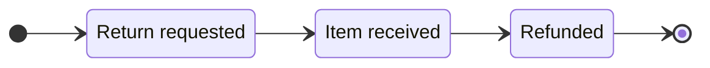

# Order Status Design

State diagrams are linked to their headings like flowcharts: each state is linked to the heading with the same text as its description, or as its id when it has none. Composite states are linked too.

## States

### Pending

The order is created and waits for the payment, for up to 30 minutes.

### Paid

The payment was captured. The order goes to the warehouse.

### Cancelled

The order was not paid in time, or the customer cancelled it before the payment.

### Fulfillment

The warehouse prepares the order. The customer can no longer cancel it.

#### Picking

The items are taken from the shelves and packed.

#### Shipped

The carrier has the parcel. The tracking number is shown in the order history.

### Delivered to the customer

Linked to the state "Delivered" by `%% @ref`. The carrier reported the delivery, and the order is closed.

<!-- link-headings:end -->

## Return Flow

A horizontal state diagram (`direction LR` or `RL`) is too wide to put beside its headings, so they are always shown below it.

### Return requested

The customer asked for a return within 14 days of the delivery.

### Item received

The warehouse checked the returned item.

### Refunded

The payment was refunded to the customer.
